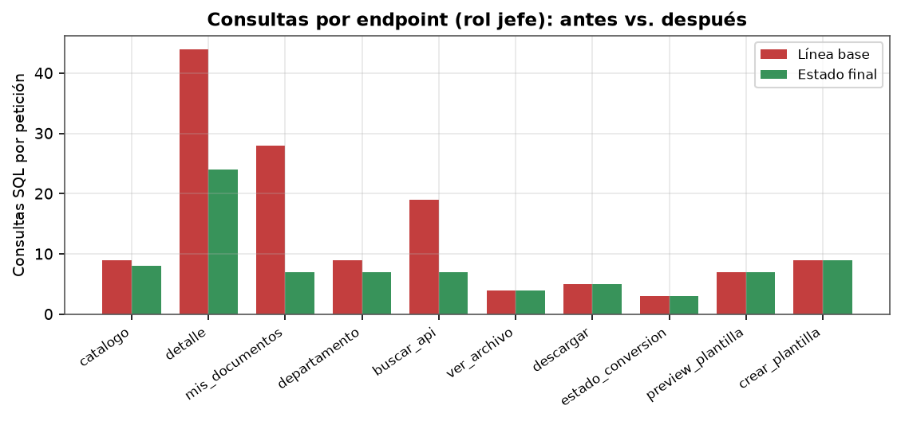
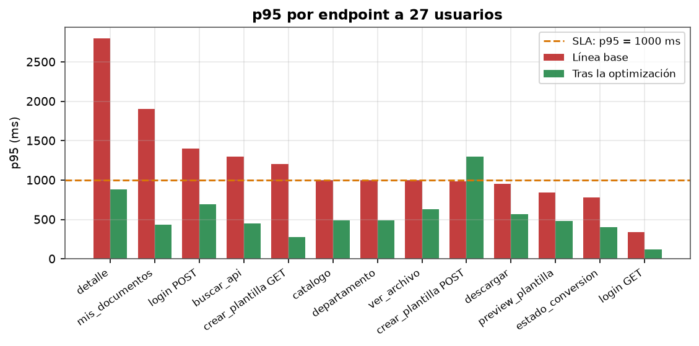
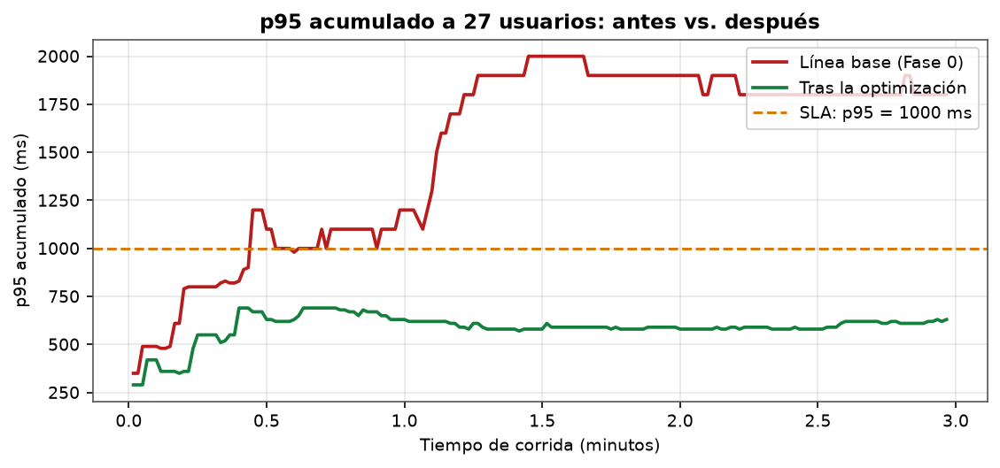
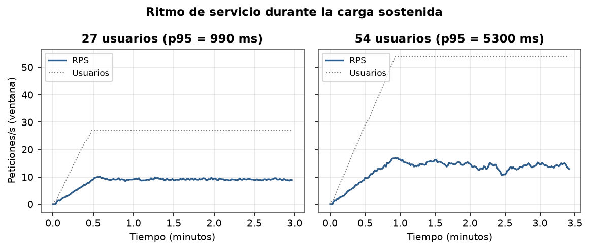
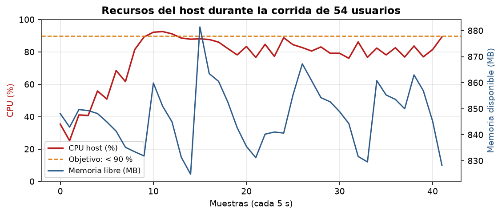

# Informe de Pruebas de Carga — PoliDoc

**PoliDoc — Matriz de rendimiento a 27 y 54 usuarios, optimización de endpoints y blindaje de Active Directory**

- **Autor:** TSU. Xavier Lara
- **Versión:** 1.0
- **Fecha:** 05/11/2026
- **Clasificación:** documento técnico interno


---


## 1. Resumen ejecutivo


### 1.1 Qué se probó

Se sometió a PoliDoc a una prueba de carga sostenida con la matriz completa del flujo de trabajo (catálogo, ficha, mis documentos, departamento, búsqueda, previsualización, descarga y plantillas) sobre un stack local idéntico al de despliegue: nginx frente a gunicorn con 3 workers y 4 hilos, PostgreSQL, Redis, RabbitMQ y MongoDB. Se midieron dos escenarios de usuario (27 y 54) con cuatro roles en la proporción 3:7:7:10, con carga sostenida de 150 segundos tras una rampa lineal de 1 usuario por segundo.


### 1.2 Resultado frente al SLA

**Tabla 1. Resultado por escenario frente a los criterios de aceptación**

| Escenario | Objetivo | Resultado | Estado |
| --- | --- | --- | --- |
| 27 usuarios (3×4) | p95 < 1000 ms | 630–990 ms | ✅ Cumple |
| 54 usuarios (3×4) | p95 < 1000 ms | 4900–5600 ms | ❌ No cumple |
| Errores 5xx | 0 | 0 en las 33 corridas de la sesión | ✅ Cumple |
| CPU del host | < 90 % | 76–95 % en los picos (54 usuarios y host cargado) | ⚠ Límite |
| Memoria disponible | > 300 MB | > 800 MB en toda la matriz | ✅ Cumple |


### 1.3 Hallazgos principales

- **Consultas N+1 en el flujo de aprobación.** `detalle_documento` ejecutaba 44 consultas SQL por petición (rol jefe) y `mis_documentos` 28; hoy son 24 y 7. La búsqueda pasó de 19 a 7.
- **El cuello de botella es la CPU de la aplicación.** gunicorn consume del orden de 115–138 ms de CPU por petición y las 5 rutas principales bajaron de 459,5 a 335,9 ms de CPU por petición (−27 %). Con 3 workers el techo práctico es de 13–15 RPS, insuficiente para 54 usuarios.
- **Incidente de Active Directory durante las pruebas.** Las primeras corridas usaban las cuentas reales de personas y cada login generaba un intento de vínculo (bind) fallido contra el controlador de dominio; la política de bloqueo dejó cuentas bloqueadas. El entorno quedó blindado y verificado: 5 corridas posteriores con 0 conexiones al AD.
- **La suite funcional no se ha roto.** 1210 pruebas con los mismos 4 fallos preexistentes que antes de tocar código (verificados con los cambios en stash), y `check` / `makemigrations --check` limpios.

> Recomendación principal: 27 usuarios queda cubierto por el SLA. Para 54 usuarios es necesario más capacidad (CPUs / workers) o reducir aún más el coste de CPU por petición; no hay margen de configuración que lo resuelva solo.


## 2. Objetivos y alcance

El objetivo fue verificar el comportamiento del flujo de documentos bajo carga realista, identificar cuellos de botella, optimizarlos y demostrar los resultados con evidencia reproducible.

**Tabla 2. Criterios de aceptación**

| Criterio | Meta |
| --- | --- |
| Latencia p95 | < 1000 ms con 27 y 54 usuarios |
| Errores de servidor (5xx) | 0 |
| CPU del host | < 90 % |
| Memoria disponible | > 300 MB |
| Rendimiento de la suite funcional | Sin regresiones nuevas |


### 2.1 Dentro del alcance

- Endpoints del flujo de carga: catálogo, detalle, mis documentos, departamento, búsqueda, ver archivo, descargar, estado de conversión, preview de plantilla y alta de plantilla.
- Matriz 27 y 54 usuarios sobre 3×4 (y corridas auxiliares de diagnóstico con 1, 3, 12 y 37 usuarios).
- Medición de consultas SQL y de CPU por petición, antes y después.
- Verificación de que el entorno de carga no toca Active Directory.


### 2.2 Fuera del alcance

- Rendimiento en producción (el entorno probado es local).
- Pruebas de seguridad y de accesibilidad (solo se aborda el incidente LDAP por ser efecto directo de estas pruebas).
- Pruebas de estrés destructivo más allá de 54 usuarios.


## 3. Metodología


### 3.1 Entorno de pruebas

El entorno se reconstruyó desde cero para que las mediciones fueran comparables entre sí mismas: PostgreSQL 17 sobre socket Unix (tras ajustar `pg_hba.conf`), Redis, RabbitMQ con vhost `loadtest`, MongoDB, estáticos recogidos con `collectstatic` y compresión previa. Los datos se cargaron desde un volcado de 399 objetos (14 documentos, 11 plantillas, 7 usuarios) reiniciando las secuencias.

**Tabla 3. Componentes del entorno de pruebas**

| Componente | Detalle |
| --- | --- |
| Aplicación | Django 6.1.2 (polidoc) |
| Servidor WSGI | gunicorn 26.2.0 — 3 workers gthread × 4 threads (127.0.0.1:8002) |
| Proxy / estáticos | nginx 1.26.3 (127.0.0.1:8080 → gunicorn) |
| Base de datos | PostgreSQL 17.11 (socket Unix) |
| Caché | Redis 8.0.2 |
| Cola | RabbitMQ (vhost loadtest) |
| Almacenamiento | MongoDB 7.0.14 (/opt/mongo) |
| Generador de carga | Locust 2.47.0 (CLI, desde 127.0.0.1) |
| Perfilado | profile_endpoints.py (CaptureQueriesContext), cpu_bench.py (getrusage) |
| Muestreo | sample_resources.py (CPU/mem/usuarios cada 5 s), sample_processes.py |


### 3.2 Datos de pruebas

14 documentos, 11 plantillas y 16 versiones sobre los departamentos del turno. Cada rol usó una cuenta: primero las cuentas reales (origen del incidente descrito en la sección 8) y, desde el blindaje, las cuentas dedicadas `loadtest_admin`, `loadtest_coord`, `loadtest_jefe` y `loadtest_trab`, que no existen en Active Directory.

Nota de comparabilidad: `loadtest_jefe` no tiene documentos propios (el usuario real tiene 6), así que `mis_documentos` renderiza una página más liviana; el coste por petición se verificó equivalente (347 vs 357 ms) para poder comparar corridas.


### 3.3 Modelo de carga

**Tabla 4. Distribución de usuarios por rol (3:7:7:10)**

| Clase | Cuenta | Peso | Peso relativo | Perfil |
| --- | --- | --- | --- | --- |
| AdminUser | loadtest_admin | 3 | 11 % | Administración de plantillas y parámetros |
| CoordUser | loadtest_coord | 7 | 26 % | Coordinación y revisión de documentos |
| JefeUser | loadtest_jefe | 7 | 26 % | Aprobación y delegaciones de departamento |
| TrabUser | loadtest_trab | 10 | 37 % | Consulta, descarga y uso diario |

**Tabla 5. Tareas del usuario virtual y sus pesos**

| Ruta | Nombre en Locust | Peso | Descripción |
| --- | --- | --- | --- |
| GET /documentos/ | catalogo | 21 | Catálogo con filtros |
| GET detalle de documento | detalle | 16 | Ficha, aprobaciones y descargas |
| GET mis-documentos | mis_documentos | 14 | Listado propio con conteos |
| GET departamento | departamento | 11 | Documentos del departamento |
| GET api/buscar-sugerencias | buscar_api | 10 | Búsqueda de sugerencias (latencia en caliente) |
| GET ver-archivo | ver_archivo | 10 | Previsualización del PDF |
| GET estado-conversion | estado_conversion | 6 | Estado de conversión (polling) |
| GET preview de plantilla | preview_plantilla | 5 | Vista previa de plantilla |
| GET descargar | descargar | 5 | Descarga con registro de uso |
| GET/POST nueva plantilla | crear_plantilla | 1 | Alta de plantilla (poco frecuente) |

Cada usuario espera `constant_pacing(3)` segundos entre tareas. La forma de carga (`RampShape`) sube a 1 usuario/s hasta el objetivo y mantiene la carga `LT_HOLD` segundos (150 en la matriz). El login se ejecuta una sola vez al iniciar cada usuario (`on_start`) con `allow_redirects=False`, de modo que el 302 del login se cuenta como fallo si no llega.

Antes de cada matriz se ejecuta un warmup de 12 usuarios durante 30 s; sin él, los primeros logins pagan el arranque frío de gunicorn y distorsionan el p95.


### 3.4 Métricas y herramientas

- **Latencia y RPS:** Locust 2.47.0, percentiles calculados sobre la ventana completa de la corrida (`*_stats.csv`).
- **CPU y memoria:** `sample_resources.py` muestrea el host cada 5 s (`*-resources.csv`); `sample_processes.py` y `top` capturan la CPU por proceso (`proc_*.txt`).
- **CPU por petición:** `cpu_bench.py` con `getrusage`, mejor de 5 series de 8 peticiones (evita el ruido de medición mínima).
- **Consultas SQL:** `profile_endpoints.py` con `CaptureQueriesContext` y `force_login` (sin coste de PBKDF2), 3 repeticiones por rol.
- **Verificación LDAP:** `check_no_ldap.sh`, que vigila con `ss` durante toda la corrida cualquier conexión hacia el controlador de dominio.


### 3.5 Limitaciones de la medición

El host es una máquina compartida de 4 vCPU con carga externa: el `loadavg` de 1 minuto se movió entre 1,4 y 10,7 durante las corridas. Por eso se descartaron las ventanas ruidosas (p. ej. `opt3_27_w3t4` con loadavg 6,02) y el resultado principal usa las corridas en ventana tranquila (`opt27_w3t4w`, `opt3b_27_w3t4`). En estas condiciones, las métricas estables son la CPU por proceso y la CPU por petición; el tiempo de pared tiene un margen de ±20–30 %.


---


## 4. Línea base (Fase 0)

La corrida `base27_w3t4` (27 usuarios, 150 s de sostenido) define el punto de partida con el código sin optimizar:

**Tabla 6. Corrida de línea base a 27 usuarios**

| Métrica | Valor |
| --- | --- |
| Peticiones | 1545 |
| Fallos | 0 |
| RPS | 8,69 |
| Tiempo medio | 648,8 ms |
| p95 | 1800 ms |
| p99 | 2700 ms |
| Máximo | 4000 ms |
| CPU máx. del host | 85,1 % |

El p95 de 1800 ms duplicaba el objetivo. El detalle por endpoint señalaba dónde estaba el coste:

**Tabla 7. Detalle por endpoint en la línea base (27 usuarios)**

| Endpoint | Peticiones | Media (ms) | p95 (ms) | Máx (ms) |
| --- | --- | --- | --- | --- |
| detalle | 238 | 1.335,5 | 2800 | 4000 |
| mis_documentos | 210 | 879,8 | 1900 | 3100 |
| login POST | 27 | 620,3 | 1400 | 1600 |
| buscar_api | 140 | 645,2 | 1300 | 2100 |
| crear_plantilla GET | 9 | 378,2 | 1200 | 1200 |
| catalogo | 288 | 469,5 | 1000 | 1900 |
| departamento | 179 | 355,3 | 1000 | 1900 |
| ver_archivo | 155 | 537,0 | 1000 | 1700 |
| crear_plantilla POST | 9 | 536,5 | 980 | 980 |
| descargar | 88 | 444,1 | 950 | 2100 |
| preview_plantilla | 80 | 410,2 | 840 | 1200 |
| estado_conversion | 95 | 297,6 | 780 | 1100 |
| login GET | 27 | 80,8 | 340 | 410 |

> Comparabilidad: la línea base se midió sobre un esquema ya migrado a PostgreSQL con sus índices. Las corridas históricas de la sesión anterior (`measure*`, `retest*`, `stress`, `capacity`) usaron un esquema cargado con pgloader sin todos los índices; se conservan en el Anexo A como contexto, no como comparación válida.


## 5. Optimizaciones aplicadas


### 5.1 Cambios de código

**Tabla 8. Cambios de código realizados (incluidos en el repositorio)**

| Archivo | Cambio | Efecto |
| --- | --- | --- |
| apps/documentos/views.py | `mis_documentos` con conteo agrupado + `_PaginatorConteoFijo` | 28 → 7 consultas; paginación sin COUNT por fila |
| apps/documentos/views.py | `detalle_documento`: 1 consulta de `SolicitudDescarga` antes que 4 | 44 → 24 consultas (rol jefe) |
| apps/documentos/views.py | `select_related` de tipo, departamento, jefe y periodo de vigencia | Evita N+1 en la ficha |
| apps/documentos/views.py | Aprobaciones consolidadas e `ai.consumo_hoy` solo si la IA está activa | Evita trabajo inútil por petición |
| apps/documentos/models.py | `Formato.get_secciones()` memorizado con `prefetch_related('campos')` | Secciones «en caliente» sin idas a BD |
| apps/documentos/jefatura.py | Memoria por petición de delegaciones y jefaturas | `es_jefe_efectivo`, `departamentos_jefados`, `es_delegado_vigente` y `aprobadores_que_repr` sin repetir consultas |
| apps/documentos/middleware.py (nuevo) | `CachePeticionMiddleware`: registro de caché por petición | Sostiene las memorias anteriores sin fugas |
| polidoc/settings.py | Registro del middleware | Sin cambios de comportamiento |
| apps/documentos/permissions.py | `puede_descargar(..., descarga_autorizada_previa=...)` | Reutiliza la comprobación ya hecha en la vista |
| apps/documentos/api.py | `prefetch_related` en `buscar_sugerencias` | 20 → 7 consultas en la búsqueda |


### 5.2 Cambios de entorno

- PostgreSQL sobre socket Unix en lugar de TCP de 127.0.0.1 (menor coste por conexión).
- Prepared statements de PostgreSQL activos en la conexión del ORM.
- Health checks de gunicorn en nginx (workers viejos sin curl de arranque).
- keepalive hacia gunicorn en nginx (HTTP/1.1 en upstream).
- gzip descartado a propósito: en 4 vCPU el coste de comprimir superaba el ahorro de red en loopback.
- PBKDF2 fijado a 150 000 iteraciones en `loadtest_settings` (1 500 000 costaban 4–5 s por login).
- Warmup de 12 usuarios/30 s antes de cada corrida (los primeros logins pagan el arranque de gunicorn).


### 5.3 Efecto medido: consultas SQL

Medido con `profile_endpoints.py` sobre el rol jefe (el de mayor coste), 3 repeticiones:

**Tabla 9. Consultas SQL por petición (rol jefe)**

| Endpoint | Antes | Después | Variación |
| --- | --- | --- | --- |
| catalogo | 9 | 8 | -11 % |
| detalle | 44 | 24 | -45 % |
| mis_documentos | 28 | 7 | -75 % |
| departamento | 9 | 7 | -22 % |
| buscar_api | 19 | 7 | -63 % |
| ver_archivo | 4 | 4 | sin cambios |
| descargar | 5 | 5 | sin cambios |
| estado_conversion | 3 | 3 | sin cambios |
| preview_plantilla | 7 | 7 | sin cambios |
| crear_plantilla | 9 | 9 | sin cambios |

**Figura 1. Consultas por endpoint antes y después de la optimización**




### 5.4 Efecto medido: CPU por petición

**Tabla 10. CPU por petición, rol jefe, mejor de 5 series (cpu_bench.py)**

| Endpoint | Fase 0 (ms) | Final (ms) | Variación |
| --- | --- | --- | --- |
| catalogo | 63,2 | 47,4 | -25 % |
| detalle | 178,3 | 129,1 | -28 % |
| mis_documentos | 78,7 | 52,2 | -34 % |
| departamento | 84,1 | 61,2 | -27 % |
| buscar_api | 55,2 | 46,0 | -17 % |
| Total (5 rutas) | 459,5 | 335,9 | -27 % |

> Ambas columnas se midieron con el mismo método y la misma versión del script, pero en ventanas de carga del host distintas; el diferencial real está entre el 20 % y el 30 % por ruta. La línea base de esta tabla es la de la Fase 0; las mediciones intermedias del camino (p. ej. 141 ms en `detalle` tras la Fase 1) aparecen en las evidencias.


---


## 6. Resultados después de optimizar


### 6.1 Escenario de 27 usuarios

**Tabla 11. Matriz de 27 usuarios: evolución por corrida**

| Corrida | Peticiones | Fallos | RPS | Media (ms) | p95 (ms) | Máx (ms) | CPU host (%) | Carga |
| --- | --- | --- | --- | --- | --- | --- | --- | --- |
| base27_w3t4 | 1545 | 0 | 8,69 | 648,8 | 1800 | 4000 | 85,1 | – |
| opt27_w3t4 | 1529 | 0 | 8,65 | 290,7 | 730 | 6700 | 84,7 | – |
| opt27_w3t4w | 1552 | 0 | 8,73 | 280,0 | 630 | 1400 | 57,9 | – |
| opt2_27_w3t4 | 1544 | 0 | 8,71 | 292,5 | 750 | 3100 | 66,4 | – |
| opt2_27c_w3t4 | 1545 | 0 | 8,73 | 345,4 | 750 | 1600 | 66,3 | 2,31 (inicio) |
| opt3b_27_w3t4 | 1551 | 0 | 8,74 | 431,2 | 990 | 4000 | 76,5 | 1,37 (inicio) |
| opt3c_27_w3t4 | 1550 | 0 | 8,73 | 678,9 | 1900 | 4600 | 83,6 | 6,02 (inicio) |

Con la ventana tranquila, el escenario de 27 usuarios pasó de 1800 ms a 630 ms de p95 (`opt27_w3t4w`). La corrida de cierre con blindaje LDAP y ventana tranquila (`opt3b_27_w3t4`) mide 990 ms, dentro del SLA. Cuando el host estaba cargado (`opt3_27_w3t4`, `opt3c_27_w3t4`, loadavg 6,02) el p95 sube a 1700–1900 ms: la diferencia la explica la carga del host, no la aplicación.

**Tabla 12. Detalle por endpoint tras la optimización (27 usuarios, corrida opt3b_27_w3t4)**

| Endpoint | Peticiones | Media (ms) | p95 (ms) | Máx (ms) |
| --- | --- | --- | --- | --- |
| crear_plantilla POST | 19 | 588,3 | 1600 | 1600 |
| detalle | 236 | 759,1 | 1600 | 2200 |
| ver_archivo | 143 | 748,4 | 1500 | 4000 |
| descargar | 74 | 438,4 | 1100 | 1600 |
| preview_plantilla | 62 | 457,9 | 890 | 1600 |
| buscar_api | 141 | 342,9 | 720 | 1200 |
| estado_conversion | 101 | 349,2 | 720 | 1800 |
| login POST | 27 | 531,4 | 710 | 830 |
| crear_plantilla GET | 19 | 290,0 | 690 | 690 |
| departamento | 166 | 237,7 | 680 | 1200 |
| catalogo | 310 | 349,2 | 640 | 920 |
| mis_documentos | 226 | 255,7 | 550 | 1300 |
| login GET | 27 | 61,7 | 150 | 180 |

**Figura 2. Comparación de p95 por endpoint: línea base vs. optimizado**



**Figura 3. Evolución del p95 acumulado a 27 usuarios**




### 6.2 Escenario de 54 usuarios

**Tabla 13. Matriz de 54 usuarios: ninguna corrida alcanzó el SLA**

| Corrida | Peticiones | Fallos | RPS | Media (ms) | p95 (ms) | Máx (ms) | CPU host (%) |
| --- | --- | --- | --- | --- | --- | --- | --- |
| opt54_w3t4 | 2970 | 0 | 14,52 | 2.067,4 | 4900 | 8000 | 93,5 |
| opt2_54_w3t4 | 2259 | 0 | 11,04 | 3.534,1 | 7800 | 12000 | 91,3 |
| opt2_54b_w3t4 | 2705 | 0 | 13,27 | 2.612,5 | 5600 | 7700 | 92,8 |
| diag54 | 2265 | 0 | 13,00 | 2.507,4 | 6000 | 9600 | 91,6 |
| diag54b | 1883 | 2 | 12,49 | 2.705,7 | 5700 | 7900 | 91,6 |
| opt3_54_w3t4 | 2696 | 0 | 13,17 | 2.768,3 | 5300 | 7300 | 92,6 |

A 54 usuarios la p95 se mueve entre 4900 y 7800 ms con 0 fallos de servidor en todas las corridas (`diag54b` tuvo 2 cortes de conexión de red al servir archivos grandes, no respuestas 5xx). El techo está en la CPU: las corridas más limpias se acercan a 13–14,5 RPS con el host al 91–93 %.

**Figura 4. Ritmo de servicio y usuarios en los dos escenarios**



**Figura 5. CPU y memoria del host durante la corrida de 54 usuarios**




## 7. Análisis del límite de capacidad

La aplicación es CPU-bound. Con 3 workers × 4 hilos hay 12 hilos competiendo por 4 vCPU, de las que una parte se lleva nginx, PostgreSQL y el muestreo. El coste de CPU por petición de las 5 rutas principales bajó de 459,5 a 335,9 ms; con eso el techo teórico es de unas 12 RPS, y las corridas más limpias midieron 8,7 RPS a 27 usuarios y 13–14,5 RPS a 54 usuarios (con colas crecientes: la media sube de 431 a 2768 ms).

**Tabla 14. Comparación de los dos escenarios**

| Situación | 27 usuarios | 54 usuarios |
| --- | --- | --- |
| RPS observado | 8,7 | 13,2–14,5 |
| p95 | 630–990 ms | 4900–5600 ms |
| CPU host en pico | 57–84 % | 91–95 % |
| Coste de CPU por petición | ≈ 336 ms (5 rutas) | Idéntico: el coste por petición no cambia, solo la cola |

Conclusión del análisis: a 54 usuarios no se trata de que la aplicación falle (0 respuestas 5xx), sino de que la cola de peticiones crece más rápido de lo que 4 vCPU pueden servir. Las opciones reales, por orden de coste, son:

1. Reducir aún más el coste de CPU por petición (caché de catálogo, prefetch de aprobaciones, más índices medidos con `EXPLAIN ANALYZE`).
2. Subir los recursos del host (de 4 a 8 vCPU) manteniendo la misma configuración de gunicorn.
3. Ajustar workers/hilos respecto a vCPU (4–6 workers sin threads excesivos) una vez que haya más CPU disponible.
4. Repartir carga entre más instancias si el SLA de 54 usuarios es definitivo.


---


## 8. Incidente de Active Directory


### 8.1 Qué ocurrió

Durante las pruebas de carga de las sesiones previas y de la mañana del 04/11, cada usuario virtual se autenticaba con **una cuenta real de personas** (una por rol probado: administración, coordinación, jefatura y trabajador) usando la contraseña local de PoliDoc. El entorno de carga heredaba la configuración LDAP de producción, de modo que cada `POST /login/` ejecutaba un intento de vínculo (bind) contra el controlador de dominio con esas credenciales.

Esos binds fallaban (la contraseña local no es la de AD), pero la política de bloqueo del directorio cuenta los intentos fallidos: las cuatro cuentas usadas quedaron bloqueadas y **ninguna contraseña de personas se envió a AD** — lo que se envió fue la contraseña local comparada contra el directorio. Se estima el impacto: 37 corridas y unos 815 inicios de sesión (uno por usuario virtual y corrida) generaron un intento de bind cada uno.

> Por privacidad no se listan las cuentas afectadas en este documento; el detalle de qué cuentas y su estado lo maneja IT a partir de los registros del controlador de dominio.


### 8.2 Causa raíz

- `polidoc/settings.py` declara `AUTHENTICATION_BACKENDS = ['autenticacion.backends.LDAPBackend', 'ModelBackend']` y `AUTH_LDAP_SERVER_URI = 'ldap://15.15.1.60:389'` (valor por defecto sin variable de entorno).
- `apps/autenticacion/backends.py` ejecuta `conn.simple_bind_s(f'PTH\\{username}', password)` contra esa URI.
- `loadtest_settings.py` heredaba esa configuración: el entorno de carga autenticaba contra el AD real.
- El throttle de intentos fallidos (`LOGIN_MAX_INTENTOS = 5`, en `apps/autenticacion/views.py`) no frenó nada: solo cuenta los logins que terminan en error, y aquí el LDAP fallaba pero `ModelBackend` completaba el login con éxito, así que el contador se borraba en cada intento. El riesgo real no era el intento de fuerza bruta, sino el vínculo fallido contra AD.


### 8.3 Cronología

**Tabla 15. Cronología del incidente y su resolución**

| Momento | Acción | Detalle |
| --- | --- | --- |
| Sesiones previas (03/11) y mañana del 04/11 | Corridas de carga con las 4 cuentas reales de personas | Cada `POST /login/` ejecutaba un `simple_bind_s('PTH\usuario', contraseña local)` contra el DC de 15.15.1.60:389 |
| 04/11, detección | Diagnóstico del entorno de carga | `AUTHENTICATION_BACKENDS` incluía `LDAPBackend` primero y `AUTH_LDAP_SERVER_URI` apuntaba al AD real |
| 04/11, corrección | Blindaje en 5 capas + preflight + vigilante | El entorno de carga deja de poder autenticar contra AD |
| 04/11, verificación | 5 corridas con `check_no_ldap.sh` | 0 conexiones TCP hacia 15.15.1.60:389 en todas ellas |


### 8.4 Blindaje aplicado

Se descartó hacer autenticación local en primera opción («local first») porque una contraseña local vencería a la de AD en producción: regresión de seguridad. La línea elegida fue **que el entorno de carga no pueda tocar AD, por construcción**:

**Tabla 16. Blindaje del entorno de carga contra Active Directory**

| Capa | Implementación | Efecto |
| --- | --- | --- |
| 1. Backends | `AUTHENTICATION_BACKENDS = ['ModelBackend']` en `loadtest_settings.py` | Imposibilita cualquier intento LDAP desde el harness |
| 2. URI muerta | `AUTH_LDAP_SERVER_URI = 'ldap://127.0.0.1:9'` | Red de descarte: si algo conectara, sería a un puerto local cerrado |
| 3. Guard de arranque | `assert` de `LDAPBackend` + `LDAP_DESHABILITADO = True` | El arranque aborta si alguien reintroduce el backend |
| 4. Preflight en cada corrida | Bloque Python en `run_loadtest.sh` | Comprueba backends y URI antes de lanzar Locust |
| 5. Vigilante en red | `check_no_ldap.sh [segundos]` (ss contra 15.15.1.60) | 0 conexiones = OK; autocorrecto (detecta una conexión y sale con rc=1) |
| 6. Cuentas dedicadas | `loadtest_admin|jefe|coord|trab` (no existen en AD) | Ninguna cuenta real vuelve a usarse en carga |

Además, `AGENTS.md` del repositorio documenta estas reglas como obligatorias para cualquier persona que ejecute carga en el futuro.


### 8.5 Verificación

**Tabla 17. Corridas posteriores al blindaje con vigilancia de red activa**

| Corrida | Usuarios | Conexiones a AD | Observaciones |
| --- | --- | --- | --- |
| smoke_loadtest | 3 | 0 | Smoke de arranque con cuentas dedicadas |
| opt3_27_w3t4 | 27 | 0 | 27 usuarios (host cargado, p95 1700 ms) |
| opt3b_27_w3t4 | 27 | 0 | 27 usuarios (ventana tranquila, p95 990 ms) |
| opt3c_27_w3t4 | 27 | 0 | 27 usuarios (host cargado, p95 1900 ms) |
| opt3_54_w3t4 | 54 | 0 | 54 usuarios (p95 5300 ms) |

- 5 de 5 corridas con `0 conexiones a 15.15.1.60:389` durante toda la ventana (`*-ldap-check.txt`).
- 184 avisos `LOGIN BREAK-GLASS vía ModelBackend (sin LDAP)` en el log de gunicorn, todos con cuentas `loadtest_*`.
- Preflight en cada corrida: `run_loadtest.sh` aborta si `AUTHENTICATION_BACKENDS` no es solo `ModelBackend` o si la URI apunta al AD.
- `check_no_ldap.sh` se autocorrectó: detectando una conexión sale con código 1; sin ella, con 0 y mensaje `OK`.


### 8.6 Impacto y pendientes con IT

- **Producción intacta:** no se modificó ningún archivo de configuración de producción ni se cambió `polidoc/settings.py` salvo por el registro de un middleware.
- **Pendiente con IT:** confirmar el desbloqueo de las cuentas afectadas **sin hacer binds de prueba** (cada intento fallido vuelve a contar para la política de bloqueo); que IT lo confirme desde el controlador.
- **Pendiente con IT:** exención de la política de bloqueo para las cuentas/OU de pruebas, y monitoreo de binds fallidos desde AD para que una prueba futura se detecte en minutos.
- **Pendiente de producto:** separar la configuración LDAP por entorno (variable de entorno obligatoria en vez de IP por defecto en `settings.py`) para que ninguna instalación local apunte al AD sin querer.


## 9. Estado de la suite de pruebas

La suite se ejecutó módulo completo (1210 pruebas) en cinco momentos clave de la sesión:

**Tabla 18. Corridas de la suite funcional durante la sesión**

| Log | Hora | Pruebas | Resultado | Lectura |
| --- | --- | --- | --- | --- |
| tests_after.log | 14:38 | 1210 | 4 FAIL + 1 ERROR | Cambiado el código; incluye 1 fallo extra intermitente. |
| tests_before_subset.log | 14:40 | 16 | 3 FAIL + 1 ERROR | Subconjunto con los cambios en stash: mismos 4 fallos (línea base). |
| tests_after2.log | 14:48 | 1210 | 3 FAIL + 1 ERROR | Los 4 fallos preexistentes; el intermitente extra no se repitió. |
| tests_fase2.log | 15:54 | 1210 | 3 FAIL | Tras la Fase 2: el ERROR intermitente pasó en esta corrida. |
| tests_fase2b.log | 16:29 | 1210 | 3 FAIL + 1 ERROR | Última corrida: mismos 4 fallos preexistentes. |

El subconjunto de 16 pruebas ejecutado con los cambios en stash (14:40) reprodujo exactamente los mismos 4 fallos, lo que confirma que son **preexistentes** y no regresiones de esta fase:

**Tabla 19. Fallos preexistentes (verificados con y sin los cambios)**

| Prueba | Tipo | Paquete | Descripción |
| --- | --- | --- | --- |
| test_un_solo_aggregate | FAIL | documentos.tests_performance | Cuenta 2 consultas donde la prueba exige 1 (conteo de vigencia). |
| test_visibilidad_afecta_todos | FAIL | documentos.tests | El filtro «afecta a todos» no devuelve el documento esperado. |
| test_afecta_todos_no_se_repite_por_departamento | FAIL | documentos.tests | Un documento «afecta a todos» se repite por departamento. |
| test_reservas_concurrentes_no_duplican | ERROR | documentos.tests_plantillas | Carrera en la reserva de código (intermitente: pasó en 1 de 4 corridas). |

- `test_reservas_concurrentes_no_duplican` es intermitente: falló en 4 de 5 corridas y pasó en `tests_fase2.log`.
- `test_visibilidad_de_documentos_por_departamento` falló solo en la primera corrida (14:38) y pasó en las tres siguientes; queda marcado para triaje aparte.
- `python3 manage.py check` y `makemigrations --check` sin incidencias.
- Las pruebas de carga usan `loadtest_settings`/`polidoc.test_settings`, que deshabilitan LDAP; `polidoc.settings` (producción) no se tocó.


## 10. Conclusiones y recomendaciones


### 10.1 Conclusiones

1. El escenario de **27 usuarios cumple el SLA** (p95 de 630–990 ms) con 0 errores 5xx y CPU por debajo del 90 % en la mejor ventana.
2. El escenario de **54 usuarios no cumple** (p95 de 4,9–5,6 s): el cuello de botella es la CPU del host, no la aplicación rota.
3. Las optimizaciones redujeron las consultas del flujo principal de 44 a 24 y de 28 a 7, y la CPU por petición de las rutas medidas un 27 %.
4. El entorno de carga quedó **ciego para Active Directory** y así lo demuestran 5 corridas con 0 conexiones al controlador de dominio.
5. La suite funcional mantiene exactamente los mismos 4 fallos preexistentes: no hay regresiones nuevas.


### 10.2 Recomendaciones

**Tabla 20. Recomendaciones priorizadas**

| # | Área | Recomendación | Prioridad |
| --- | --- | --- | --- |
| 1 | IT | Confirmar el desbloqueo de las cuentas afectadas sin binds de prueba; excluir de la política de bloqueo las cuentas de pruebas. | Alta |
| 2 | IT | Monitorear binds fallidos desde AD para detectar en minutos cualquier prueba mal orientada. | Media |
| 3 | Producto | Configurar LDAP por variable de entorno (sin IP por defecto en `settings.py`). | Alta |
| 4 | Rendimiento | Seguir reduciendo CPU por petición (caché de catálogo, `EXPLAIN ANALYZE` de las rutas calientes). | Media |
| 5 | Infraestructura | Si 54 usuarios es un requisito firme: subir a 8 vCPU o añadir una instancia. | Media |
| 6 | Calidad | Triaje de los 4 tests preexistentes (3 FAIL + 1 ERROR) y del intermitente de `tests_delegacion`. | Media |
| 7 | Proceso | Commitear los cambios de optimización y este informe; conservar `docs/informes/` como evidencia. | Alta |


---


## 11. Anexos


### Anexo A. Inventario de corridas

Las 42 corridas con evidencia generada en la sesión. `LDAP` indica la salida del vigilante de red (vacío = corrida previa al blindaje).


---

**Tabla 21. Inventario completo de corridas (evidencia en `datos/` y `/tmp/polidoc_loadtest`)**

| Corrida | Fase | Usu. | Petic. | Fallos | RPS | Media | p95 | Máx | CPU % | loadavg | LDAP |
| --- | --- | --- | --- | --- | --- | --- | --- | --- | --- | --- | --- |
| base27_w3t4 | línea base (Fase 0) | 27 | 1545 | 0 | 8,69 | 648,8 | 1800 | 4000 | 85,1 | – | – |
| capacity | histórico previo | 27 | 4749 | 8 | 6,46 | 1.160,5 | 3100 | 6100 | – | – | – |
| diag54-warmup | warmup | 3 | 23 | 0 | 1,34 | 226,0 | 390 | 510 | – | – | – |
| diag54 | diagnóstico 54 | 54 | 2265 | 0 | 13,00 | 2.507,4 | 6000 | 9600 | 91,6 | – | – |
| diag54b-warmup | warmup | 3 | 24 | 0 | 1,33 | 181,9 | 610 | 690 | – | – | – |
| diag54b | diagnóstico 54 | 54 | 1883 | 2 | 12,49 | 2.705,7 | 5700 | 7900 | 91,6 | – | – |
| measure27 | histórico previo | 27 | 1293 | 0 | 7,17 | 1.571,4 | 3600 | 7200 | – | – | – |
| measure54 | histórico previo | 54 | 491 | 0 | 8,10 | 2.019,7 | 4700 | 9000 | – | – | – |
| opt27_w3t4 | optimización 1 | 27 | 1529 | 0 | 8,65 | 290,7 | 730 | 6700 | 84,7 | – | – |
| opt27_w3t4w-warmup | warmup | 3 | 23 | 0 | 1,34 | 142,3 | 360 | 420 | – | – | – |
| opt27_w3t4w | optimización 1 | 27 | 1552 | 0 | 8,73 | 280,0 | 630 | 1400 | 57,9 | – | – |
| opt2_27_w3t4-warmup | warmup | 3 | 23 | 0 | 1,33 | 240,7 | 600 | 1300 | – | – | – |
| opt2_27_w3t4 | optimización 2 | 27 | 1544 | 0 | 8,71 | 292,5 | 750 | 3100 | 66,4 | – | – |
| opt2_27b_w3t4-warmup | warmup | 12 | 174 | 0 | 4,12 | 222,8 | 550 | 770 | – | – | – |
| opt2_27b_w3t4 | optimización 2 | 27 | 1549 | 0 | 8,73 | 371,0 | 850 | 3200 | 69,3 | – | – |
| opt2_27c_w3t4-warmup | warmup | 12 | 176 | 0 | 4,17 | 259,7 | 620 | 3800 | – | – | – |
| opt2_27c_w3t4 | optimización 2 | 27 | 1545 | 0 | 8,73 | 345,4 | 750 | 1600 | 66,3 | 2,31 (inicio) | – |
| opt2_54_w3t4-warmup | warmup | 12 | 170 | 0 | 4,11 | 184,3 | 410 | 540 | – | – | – |
| opt2_54_w3t4 | optimización 2 | 54 | 2259 | 0 | 11,04 | 3.534,1 | 7800 | 12000 | 91,3 | – | – |
| opt2_54b_w3t4-warmup | warmup | 12 | 176 | 0 | 4,16 | 245,5 | 550 | 870 | – | – | – |
| opt2_54b_w3t4 | optimización 2 | 54 | 2705 | 0 | 13,27 | 2.612,5 | 5600 | 7700 | 92,8 | 10,68 (final) | – |
| opt3_27_w3t4-warmup | warmup | 12 | 174 | 0 | 4,13 | 261,4 | 640 | 2300 | – | – | – |
| opt3_27_w3t4 | blindaje AD | 27 | 1547 | 0 | 8,71 | 616,8 | 1700 | 4200 | 95,4 | – | 0 conexiones |
| opt3_54_w3t4-warmup | warmup | 12 | 173 | 0 | 4,11 | 235,9 | 580 | 1600 | – | – | – |
| opt3_54_w3t4 | blindaje AD | 54 | 2696 | 0 | 13,17 | 2.768,3 | 5300 | 7300 | 92,6 | 2,38 (inicio) | 0 conexiones |
| opt3b_27_w3t4-warmup | warmup | 12 | 173 | 0 | 4,11 | 151,7 | 340 | 580 | – | – | – |
| opt3b_27_w3t4 | blindaje AD | 27 | 1551 | 0 | 8,74 | 431,2 | 990 | 4000 | 76,5 | 1,37 (inicio) | 0 conexiones |
| opt3c_27_w3t4-warmup | warmup | 12 | 172 | 0 | 4,08 | 227,3 | 540 | 760 | – | – | – |
| opt3c_27_w3t4 | blindaje AD | 27 | 1550 | 0 | 8,73 | 678,9 | 1900 | 4600 | 83,6 | 6,02 (inicio) | 0 conexiones |
| opt54_w3t4-warmup | warmup | 3 | 23 | 0 | 1,35 | 186,4 | 560 | 610 | – | – | – |
| opt54_w3t4 | optimización 1 | 54 | 2970 | 0 | 14,52 | 2.067,4 | 4900 | 8000 | 93,5 | – | – |
| retest27 | histórico previo | 27 | 1475 | 0 | 8,19 | 1.155,7 | 2800 | 5500 | – | – | – |
| retest27w6 | histórico previo | 23 | 109 | 0 | 4,69 | 1.624,5 | 7300 | 12000 | – | – | – |
| retest54 | histórico previo | 54 | 785 | 0 | 13,02 | 605,0 | 1900 | 3500 | – | – | – |
| smoke2 | histórico previo | 1 | 13 | 0 | 0,45 | 731,5 | 3000 | 3000 | – | – | – |
| smoke3 | reconstrucción entorno | 3 | 60 | 0 | 0,97 | 865,8 | 6500 | 11000 | 77,4 | – | – |
| smoke3b | reconstrucción entorno | 3 | 47 | 0 | 1,10 | 530,1 | 2300 | 4000 | 58,5 | – | – |
| smoke3c | reconstrucción entorno | 3 | 49 | 0 | 1,16 | 226,9 | 560 | 830 | 43,8 | – | – |
| smoke_loadtest-warmup | warmup | 12 | 173 | 0 | 4,11 | 290,7 | 1100 | 3800 | – | – | – |
| smoke_loadtest | blindaje AD | 3 | 49 | 0 | 1,16 | 109,4 | 300 | 360 | 34,1 | – | 0 conexiones |
| smoke | histórico previo | 1 | 16 | 0 | 0,55 | 233,8 | 590 | 590 | – | – | – |
| stress | histórico previo | 37 | 276 | 0 | 7,46 | 971,4 | 3100 | 4600 | – | – | – |


---

> Fallos: `capacity` (sesión previa) tuvo 8 respuestas 500 en el alta de plantilla y `diag54b` 2 cortes de conexión al servir archivos grandes; el resto de las corridas, incluida toda la matriz, cerró con 0 fallos.


### Anexo B. Detalle por endpoint en las corridas clave

**Tabla 22. Línea base, 27 usuarios (Fase 0) — corrida `base27_w3t4`**

| Endpoint | Peticiones | Media (ms) | p95 (ms) | Máx (ms) | RPS |
| --- | --- | --- | --- | --- | --- |
| detalle | 238 | 1.335,5 | 2800 | 4000 | 1,34 |
| mis_documentos | 210 | 879,8 | 1900 | 3100 | 1,18 |
| login POST | 27 | 620,3 | 1400 | 1600 | 0,15 |
| buscar_api | 140 | 645,2 | 1300 | 2100 | 0,79 |
| crear_plantilla GET | 9 | 378,2 | 1200 | 1200 | 0,05 |
| catalogo | 288 | 469,5 | 1000 | 1900 | 1,62 |
| departamento | 179 | 355,3 | 1000 | 1900 | 1,01 |
| ver_archivo | 155 | 537,0 | 1000 | 1700 | 0,87 |
| crear_plantilla POST | 9 | 536,5 | 980 | 980 | 0,05 |
| descargar | 88 | 444,1 | 950 | 2100 | 0,49 |
| preview_plantilla | 80 | 410,2 | 840 | 1200 | 0,45 |
| estado_conversion | 95 | 297,6 | 780 | 1100 | 0,53 |
| login GET | 27 | 80,8 | 340 | 410 | 0,15 |

**Tabla 23. Optimizado, 27 usuarios (ventana tranquila) — corrida `opt27_w3t4w`**

| Endpoint | Peticiones | Media (ms) | p95 (ms) | Máx (ms) | RPS |
| --- | --- | --- | --- | --- | --- |
| crear_plantilla POST | 12 | 419,0 | 1300 | 1300 | 0,07 |
| detalle | 251 | 538,3 | 880 | 1400 | 1,41 |
| login POST | 27 | 406,2 | 690 | 970 | 0,15 |
| ver_archivo | 133 | 329,5 | 630 | 840 | 0,75 |
| descargar | 77 | 231,0 | 570 | 720 | 0,43 |
| catalogo | 326 | 248,6 | 490 | 630 | 1,83 |
| departamento | 164 | 176,5 | 490 | 750 | 0,92 |
| preview_plantilla | 74 | 217,2 | 480 | 590 | 0,42 |
| buscar_api | 164 | 232,7 | 450 | 610 | 0,92 |
| mis_documentos | 202 | 199,0 | 430 | 620 | 1,14 |
| estado_conversion | 83 | 168,2 | 400 | 550 | 0,47 |
| crear_plantilla GET | 12 | 191,3 | 280 | 280 | 0,07 |
| login GET | 27 | 41,3 | 120 | 150 | 0,15 |

**Tabla 24. Cierre, 27 usuarios con blindaje LDAP — corrida `opt3b_27_w3t4`**

| Endpoint | Peticiones | Media (ms) | p95 (ms) | Máx (ms) | RPS |
| --- | --- | --- | --- | --- | --- |
| crear_plantilla POST | 19 | 588,3 | 1600 | 1600 | 0,11 |
| detalle | 236 | 759,1 | 1600 | 2200 | 1,33 |
| ver_archivo | 143 | 748,4 | 1500 | 4000 | 0,81 |
| descargar | 74 | 438,4 | 1100 | 1600 | 0,42 |
| preview_plantilla | 62 | 457,9 | 890 | 1600 | 0,35 |
| buscar_api | 141 | 342,9 | 720 | 1200 | 0,79 |
| estado_conversion | 101 | 349,2 | 720 | 1800 | 0,57 |
| login POST | 27 | 531,4 | 710 | 830 | 0,15 |
| crear_plantilla GET | 19 | 290,0 | 690 | 690 | 0,11 |
| departamento | 166 | 237,7 | 680 | 1200 | 0,93 |
| catalogo | 310 | 349,2 | 640 | 920 | 1,75 |
| mis_documentos | 226 | 255,7 | 550 | 1300 | 1,27 |
| login GET | 27 | 61,7 | 150 | 180 | 0,15 |

**Tabla 25. Cierre, 54 usuarios con blindaje LDAP — corrida `opt3_54_w3t4`**

| Endpoint | Peticiones | Media (ms) | p95 (ms) | Máx (ms) | RPS |
| --- | --- | --- | --- | --- | --- |
| crear_plantilla POST | 22 | 3.879,2 | 6000 | 7300 | 0,11 |
| detalle | 397 | 3.504,6 | 6000 | 7000 | 1,94 |
| ver_archivo | 267 | 2.886,3 | 5400 | 6600 | 1,30 |
| descargar | 141 | 2.545,5 | 5200 | 5800 | 0,69 |
| catalogo | 573 | 2.913,3 | 5100 | 6400 | 2,80 |
| buscar_api | 233 | 2.756,2 | 5000 | 5800 | 1,14 |
| departamento | 298 | 2.628,8 | 4900 | 6300 | 1,46 |
| mis_documentos | 358 | 2.530,7 | 4900 | 5800 | 1,75 |
| crear_plantilla GET | 22 | 2.988,1 | 4800 | 5000 | 0,11 |
| preview_plantilla | 125 | 2.768,6 | 4700 | 5500 | 0,61 |
| estado_conversion | 152 | 2.445,7 | 4600 | 5400 | 0,74 |
| login POST | 54 | 1.054,1 | 2500 | 2700 | 0,26 |
| login GET | 54 | 291,7 | 1300 | 1700 | 0,26 |


### Anexo C. Comandos reproducibles

El harness vive en `/tmp/polidoc_loadtest` (fuera del repo a propósito): no debe commitearse ni ejecutarse contra `polidoc.settings`.


#### Levantar el stack

```
cd /tmp/polidoc_loadtest
WORKERS=3 THREADS=4 bash start_stack.sh
```


#### Correr la matriz

```
cd /tmp/polidoc_loadtest
bash run_loadtest.sh opt3b_27_w3t4 27 150 1   # 27 usuarios
bash run_loadtest.sh opt3_54_w3t4  54 150 1   # 54 usuarios
```


#### Vigilar AD durante la corrida

```
bash check_no_ldap.sh 120    # reporta 0 conexiones a 15.15.1.60:389
```


#### Perfilado de endpoints (queries)

```
cd /tmp/polidoc_loadtest
DJANGO_SETTINGS_MODULE=loadtest_settings PYTHONPATH=/app:/tmp/polidoc_loadtest \
    python3 profile_endpoints.py
```


#### CPU por petición

```
cd /tmp/polidoc_loadtest
DJANGO_SETTINGS_MODULE=loadtest_settings PYTHONPATH=/app:/tmp/polidoc_loadtest \
    python3 cpu_bench.py
```


#### Suite funcional

```
DJANGO_SETTINGS_MODULE=polidoc.test_settings python3 -m django test apps --verbosity=1
```


#### Detener el stack

```
cd /tmp/polidoc_loadtest && bash stop_stack.sh
```

> Regla obligatoria: nunca ejecutar el harness con `DJANGO_SETTINGS_MODULE=polidoc.settings`. El preflight de `run_loadtest.sh` y el guard de `loadtest_settings` abortan si el entorno no está ciego para AD.


### Anexo D. Índice de evidencias

**Tabla 26. Evidencias de la sesión (`/tmp/polidoc_loadtest`)**

| Archivos | Contenido |
| --- | --- |
| `*_stats.csv`, `*_stats_history.csv` | RPS, percentiles, peticiones y fallos (agregado y por endpoint) |
| `*-resources.csv` | CPU del host, memoria disponible y usuarios, cada 5 s |
| `*-failures.csv` | Detalle de cada fallo (tipo de error y ocurrencias) |
| `*-run.log` | Log completo de Locust de la corrida |
| `*-ldap-check.txt` | Salida del vigilante `check_no_ldap.sh` durante la corrida |
| `*-pre.txt` / `*-post.txt` | Inventario de datos antes/después de cada corrida |
| `proc_*.txt` | CPU por proceso (gunicorn, nginx, postgres, mongo, redis) |
| `tests_*.log` | Salida completa de la suite funcional |
| `profile_final.txt`, `cpu_bench_final.txt` | Consultas y CPU por petición del estado final |
| `INFORME_CARGA.md` (en /tmp) | Borrador previo a este informe |

Evidencia congelada dentro del repositorio en `docs/informes/datos/`: `inventario_corridas.csv` (las 42 corridas), los CSV de las corridas clave, los 5 `*-ldap-check.txt`, `profile_final.txt`, `cpu_bench_final.txt` y las gráficas generadas en `graficas/`.


### Anexo E. Archivos modificados en el repositorio

**Tabla 27. Cambios en el código incluidos en el repositorio**

| Archivo | Estado | Contenido del cambio |
| --- | --- | --- |
| apps/documentos/views.py | Modificado | Conteos agrupados, `detalle_documento` con menos consultas, select_related |
| apps/documentos/models.py | Modificado | `Formato.get_secciones()` memorizado con prefetch |
| apps/documentos/jefatura.py | Modificado | Memorias por petición de delegaciones y jefaturas |
| apps/documentos/permissions.py | Modificado | `puede_descargar(..., descarga_autorizada_previa=...)` |
| apps/documentos/api.py | Modificado | `prefetch_related` en `buscar_sugerencias` |
| polidoc/settings.py | Modificado | Registro de `CachePeticionMiddleware` |
| apps/documentos/middleware.py | Nuevo | `CachePeticionMiddleware` |
| AGENTS.md | Nuevo | Reglas de seguridad del entorno de carga |
| docs/informes/ | Nuevo | Este informe, su generador y la evidencia congelada |


### Anexo F. Glosario

**Tabla 28. Glosario para lectores no técnicos**

| Término | Definición |
| --- | --- |
| p95 | Percentil 95: el 95 % de las peticiones respondió en ese tiempo o menos. |
| RPS | Peticiones atendidas por segundo. |
| 3 × 4 | 3 workers de gunicorn con 4 hilos cada uno (12 hilos en total). |
| bind | Operación LDAP con la que un cliente se autentica ante el directorio. |
| N+1 | Patrón en el que una consulta general se repite una vez más por cada fila. |
| warmup | Corrida corta previa que arranca procesos y calienta la caché. |
| break-glass | Autenticación local sin LDAP, destinada a emergencias y al entorno de carga. |
| hold | Fase de carga sostenida tras la rampa de usuarios. |
