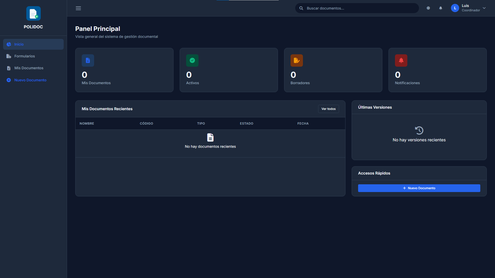

# 01. Introducción y navegación

## Qué es POLIDOC

POLIDOC es el sistema de gestión documental de la Policlínica Táchira. Sirve
para crear, aprobar, distribuir y archivar los documentos del sistema de
calidad bajo las normas **ISO 9001:2015**, **ISO 27001** e **ISO 15489**.

Con POLIDOC:

- Cada documento tiene **código**, **versión**, **estado** y **vigencia**
  controlados (ya no se aprueban documentos por correo).
- Quién descarga un documento queda **registrado** (trazabilidad ISO).
- Los documentos vencen solos y se avisa antes de que venzan.
- Los cambios sobre un documento activo se hacen por **Planilla de Cambios**,
  con aprobación.

Los tipos de documento que maneja son: Manual de la Calidad, Política,
Objetivos, Plan de la Calidad, Mapa de Procesos, Descripción de Cargos,
Programa SSL, Organigrama, Descripción de Procesos, Normas, Procedimientos
Generales y Específicos, Instructivo de Llenado, Instrucciones de Trabajo y
Formularios.

## Requisitos de acceso

| Requisito | Detalle |
|---|---|
| Cuenta | Tu usuario y contraseña de Active Directory de la institución (mismas credenciales que el equipo de trabajo) |
| Navegador | Chrome, Edge o Firefox actualizado |
| Permisos | Tu cuenta debe pertenecer a un grupo de documentación del directorio activo; si no, POLIDOC te lo indicará al entrar |
| Departamento | Debe estar asignado para poder crear documentos; si no lo tienes, contacta al administrador |

> Si olvidaste tu contraseña, se cambia en el Active Directory de la
> institución (no existe "olvidé mi contraseña" en POLIDOC).

## La pantalla principal

Al iniciar sesión caes en **Inicio** (`/inicio/`). Todas las pantallas
comparten el mismo marco:

### Menú lateral (sidebar)

| Elemento | Qué hace | Quién lo ve |
|---|---|---|
| **Inicio** | Panel de resumen | Todos |
| **Formularios** | Catálogo de formularios descargables | Todos |
| **Mis Documentos** | Tus documentos y los que te asignaron | Todos |
| **Nuevo Documento** | Selector de tipo para crear | Todos* |
| **Departamento** | Documentos y vigencia de tu departamento | Jefes y administradores |
| **Usuarios** | Lista de usuarios y asignación de departamentos | Administradores |
| **Configuración** | Catálogos, formatos y auditoría | Jefes y administradores |

\* Algunos tipos de documento solo los crean jefes; el selector los oculta.

### Barra superior (navbar)

| Elemento | Qué hace |
|---|---|
| **Buscar documentos...** | Búsqueda con autocompletado; ver cap. 04 |
| Icono de **tema** (sol/luna) | Cambia entre tema claro y oscuro |
| Icono de **campana** | Notificaciones; ver cap. 02 |
| **Tu nombre y rol** (esquina) | Abre el menú: *Mi Perfil*, *Mis Documentos*, *Cerrar Sesión* |

### Mensajes del sistema

Cada acción muestra un mensaje arriba del contenido: verde (correcto), amarillo
(advertencia) y rojo (error). No los cierres sin leerlos: explican por qué una
acción no salió como esperabas.

## Cómo usar este manual

1. Revisa la tabla **"¿Qué capítulo me toca?"** de la [portada](README.md).
2. Sigue los capítulos en orden: son instrucciones paso a paso.
3. Cuando veas una caja **Errores frecuentes**, léela antes de pedir ayuda:
   casi todos los problemas comunes están ahí.
4. El [glosario](A-glosario.md) explica términos como *vigencia*, *revisión*
   o *planilla de cambios*.

---

**Siguiente:** [02. Primeros pasos](02-primeros-pasos.md)
