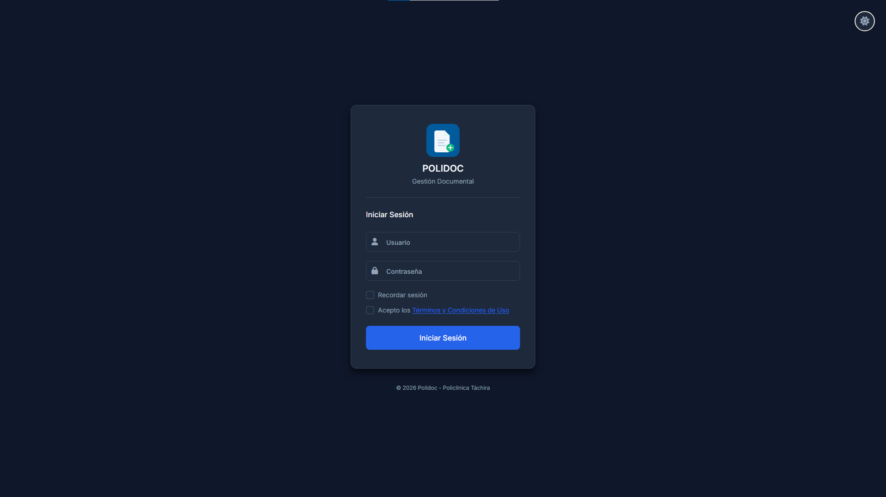
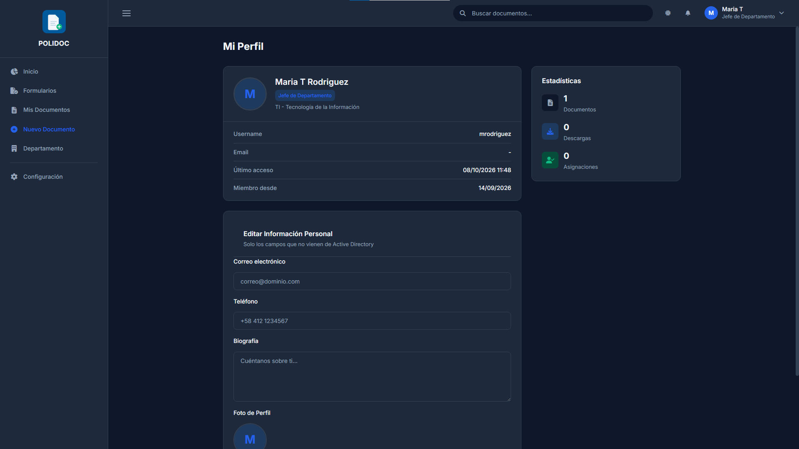
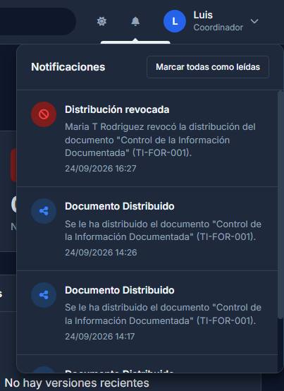

# 02. Primeros pasos: acceso, panel y perfil

## 1. Iniciar sesión

1. Abre el navegador en la dirección de POLIDOC de la institución.
2. En **Usuario** escribe tu usuario del Active Directory (sin el dominio).
3. En **Contraseña** escribe tu contraseña habitual.
4. Marca **Recordar sesión** solo si estás en un equipo personal. En equipos
   compartidos, déjalo sin marcar: la sesión se cierra al cerrar el navegador.
5. Lee y acepta los **Términos y Condiciones de Uso** (marcando la casilla de
   aceptación). Es obligatorio: sin la aceptación no se entra.
6. Pulsa **Iniciar Sesión**.

### Campos obligatorios

- Usuario y contraseña del directorio activo.
- Aceptación de los Términos y Condiciones.

Si la versión de los términos cambia, POLIDOC volverá a pedirte aceptarlos en
el siguiente inicio de sesión.

> **Recordar sesión desmarcado** = la sesión termina al cerrar la ventana.
> **Recordar sesión marcado** = permanece abierta hasta que cierres sesión.

### Errores frecuentes

| Mensaje | Causa | Solución |
|---|---|---|
| "Usuario o contraseña incorrectos." | Datos incorrectos | Verifica mayúsculas; la contraseña es la del directorio activo |
| "Tu usuario no tiene permisos para acceder a este sistema." | Tu cuenta no pertenece a ningún grupo de documentación | Solicita al administrador que te asigne grupo y departamento |
| "Demasiados intentos fallidos. Espera unos minutos antes de volver a intentar." | 5 inicios fallidos en 5 minutos | Espera unos minutos o contacta al administrador |
| "Debes aceptar los Términos y Condiciones para continuar." | No marcaste la casilla de aceptación | Marca la casilla y vuelve a pulsar *Iniciar Sesión* |
| "Se actualizaron los Términos y Condiciones (versión X). Debes aceptarlos para continuar." | Cambió la versión de los términos | Lee y acepta la versión nueva |
| Quedaste fuera sin querer | Cerraste la pestaña sin "Recordar sesión" | Vuelve a iniciar sesión |

> **Cuentas locales de emergencia.** Además del directorio activo existen
> cuentas locales de respaldo para cuando el controlador no responda. Esos
> accesos quedan registrados en la auditoría; úsalos solo si el administrador
> te lo indica.

## 2. El panel de Inicio

`/inicio/` resume tu actividad:

| Zona | Contenido |
|---|---|
| **Tarjetas de resumen** | Mis documentos, Activos, Borradores. Como jefe/administrador verás además las solicitudes pendientes de tu departamento; el resto, el número de notificaciones sin leer |
| **Mis Documentos Recientes** | Los 10 últimos que modificaste, con su estado |
| **Últimas Versiones** | Las 5 últimas versiones que creaste |
| **Logs Recientes** | Tus últimas acciones registradas (auditoría) |
| **Accesos Rápidos** | *Nuevo Documento* y, para jefes/administradores, *Departamento* |

## 3. Mi Perfil

Entra por el menú de usuario (esquina superior derecha) → **Mi Perfil**
(`/perfil/`).

**Puedes editar:** correo electrónico, teléfono, biografía y foto de perfil
(JPG, PNG, GIF o WEBP de hasta 5 MB).

**Solo lectura** (viene del directorio activo): usuario, nombre completo,
rol, departamento, cédula, número de empleado, último acceso y última
sincronización.

> Si tu rol o departamento aparece mal, no lo edites tú: el administrador
> corrige la asignación y el sistema lo sincroniza.

### Errores frecuentes

| Mensaje | Causa | Solución |
|---|---|---|
| "La imagen excede 5MB. Use una imagen más pequeña." | Foto mayor a 5 MB | Reduce la imagen antes de subirla |
| "Formato no permitido. Use JPG, JPEG, PNG, GIF o WEBP." | Extensión distinta a las admitidas | Convierte la imagen a uno de esos formatos |
| Campo en gris / no editable | Viene del directorio activo | Lo cambia el administrador |

## 4. Notificaciones

La **campana** de la barra superior muestra el número de alertas sin leer.

1. Pulsa la campana para ver las últimas notificaciones.
2. Al pulsar una notificación se abre la pantalla a la que apunta (por ejemplo,
   una solicitud esperando tu aprobación).
3. **Marcar todas como leídas** limpia el contador.

Las notificaciones llegan cuando, entre otras cosas:

- Un subordinado solicita descargar un documento de tu departamento.
- Tu documento fue evaluado/autorizado o rechazado.
- Un documento que distribuiste tiene nueva versión.
- Un documento tuyo está por vencer (7 días) o ya venció.

> No existe configuración de correo ni preferencias por tipo de notificación:
> todo llega a la campana.

## 5. Cerrar sesión

Menú de usuario → **Cerrar Sesión**. Hazlo siempre en equipos compartidos
(también lo exigen los Términos y Condiciones).

---

**Anterior:** [01. Introducción](01-introduccion.md) ·
**Siguiente:** [03. Roles y permisos](03-roles-y-permisos.md)
