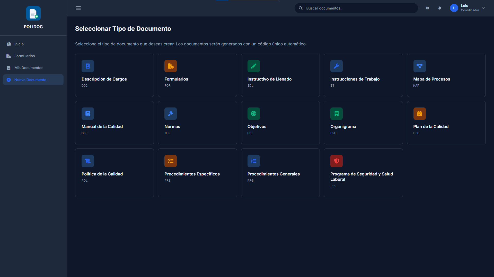
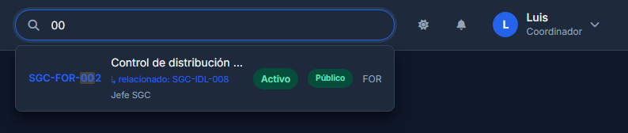
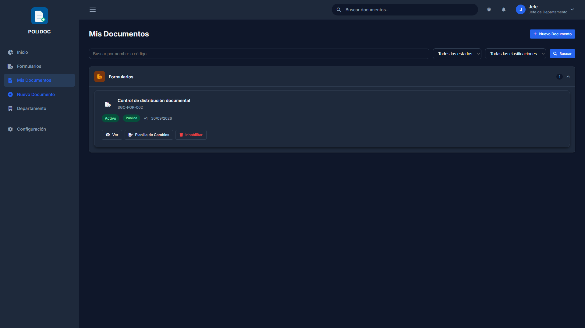
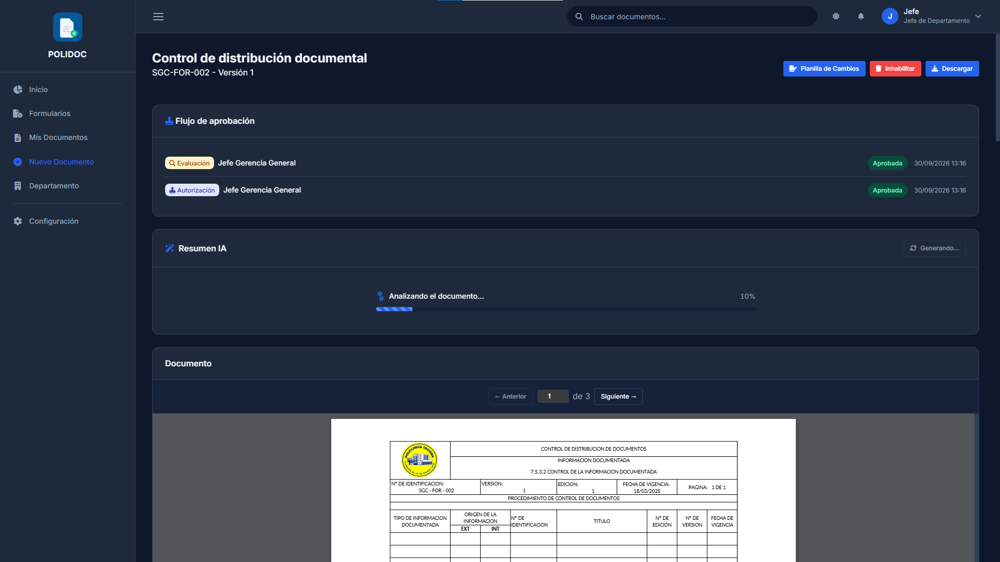
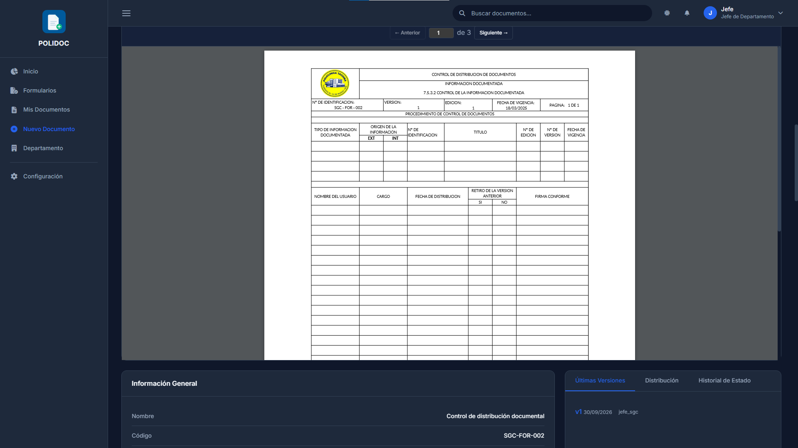

# 04. Consultar y buscar documentos

## 1. Catálogo de formularios

**Menú lateral → Formularios** (`/documentos/`): catálogo de **todos** los
formularios (tipo `FOR`) activos de la institución, con independencia de su
clasificación: públicos, internos, confidenciales y restringidos aparecen en
una sola lista. Cada ficha muestra el formulario, su clasificación y su estado
de vigencia.

La ficha indica qué puedes hacer con ese formulario:

- **Descargar** → lo tienes autorizado (público, o solicitud aprobada y
  vigente). Queda registrado en la auditoría.
- **Solicitar** → abres el formulario de solicitud de descarga (cap. 08); un
  jefe o administrador debe aprobarla.
- **Solicitud pendiente** → ya la pediste y está esperando respuesta.

> Listar un formulario en el catálogo **no da acceso a su contenido**: el
> visor solo se abre cuando tienes permiso o una solicitud aprobada. La
> búsqueda de la barra superior (§2) sí respeta los permisos de visibilidad y
> no muestra lo que no te corresponde.

> Si eres **jefe de departamento o administrador**, la cabecera de esta misma
> pantalla muestra el botón **Bandeja de Aprobaciones** (cap. 06); para los
> demás roles el botón no aparece.

## 2. Búsqueda desde la barra superior

Escribe en **"Buscar documentos..."** (barra superior). Tras tres letras
aparecen sugerencias de forma automática.

La búsqueda encuentra documentos por:

- Nombre.
- Código (por ejemplo `TI-PRG-001`).
- Propietario.
- Documentos relacionados visibles para ti.

> Solo aparecen documentos que tengas permiso de ver: un resultado que no ves
> es porque tu rol/clasificación no lo permite (cap. 03), no porque la
> búsqueda falle.

Pulsa **Enter** para ir a la página completa de resultados
(`/documentos/buscar/`), paginada.

## 3. Mis Documentos

**Menú lateral → Mis Documentos** (`/documentos/mis-documentos/`): tus
documentos y, si eres coordinador, los que te asignaron.

**Filtros disponibles:**

- **Buscar** por nombre o código.
- **Estado:** Todos los estados · Borrador · En Revisión · Activo · Obsoleto.
- **Clasificación:** Todas las clasificaciones · Público · Interno ·
  Confidencial · Restringido.
- **Orden:** por fecha de modificación.

Cada fila ofrece las acciones que tu rol y el estado del documento permiten:

| Botón | Cuándo aparece |
|---|---|
| **Ver** | Siempre (si tienes permiso) |
| **Editar Borrador** | Si eres propietario y el documento está en *Borrador* |
| **Planilla de Cambios** | Si puedes modificar el documento y no está en borrador |

## 4. La ficha del documento

Al pulsar **Ver** abres el detalle (`/documentos/<tipo>/<uuid>/`).

**Cabecera:** nombre, código y versión, más los botones de acción disponibles:
*Editar Borrador* / *Enviar a Revisión* (borrador), *Planilla de Cambios*
(documento activo), *Inhabilitar* o *Solicitar Eliminación*, *Descargar* o
*Solicitar Descarga*, y *Habilitar* / *Reactivar - Renovar* (si el documento
está obsoleto y puedes reactivarlo).

**Información principal:** estado, clasificación, versión actual, propietario,
departamento, última modificación y fechas de vigencia y vencimiento.

**Bloques de contenido:**

| Bloque | Qué contiene |
|---|---|
| Descripción | Resumen del documento |
| Departamentos Afectados | Áreas que aplican; si marca *Todos los departamentos*, incluye las futuras |
| Responsables y Participantes | Áreas responsables y personas involucradas |
| Documentos Relacionados | Enlaces a otros documentos y referencias pendientes a códigos que aún no existen |
| Control ISO 9001:2015 | Revisión, aprobado por, fechas de aprobación/vigencia/vencimiento, período de vigencia y de retención |
| Historial de Cambios | Versiones y qué cambió en cada una |
| Últimas Versiones / Distribución / Historial de Estado / Renovaciones | Trazabilidad: versiones, copias entregadas, evaluaciones y renovaciones |

**Estados de vigencia** que puedes ver como insignias (badges):

- **Vigente** (verde): sin problemas.
- **Vence pronto** (amarillo): vence en 7 días o menos.
- **Vencido** (rojo): pasó la fecha de vencimiento.

## 5. Ver el documento en pantalla

La tarjeta **Documento** de la ficha muestra el PDF dentro del navegador, con
controles de paginación (**← Anterior**, número de página, **Siguiente →**),
sin necesidad de descargarlo.

Si el archivo original es DOCX, XLSX o VSDX, POLIDOC genera el PDF de forma
automática. Si aún se está generando, verás una **barra de progreso**; espera
sin recargar (puede tardar unos segundos).

### Errores frecuentes

| Mensaje | Causa | Solución |
|---|---|---|
| "No tienes permisos para ver este documento" | Fuera de tu alcance | Solicita acceso o distribución |
| "El archivo de este documento no está disponible en el almacenamiento" | El PDF/origen no se subió o se movió el archivo | Contacta al administrador |
| La barra de conversión no termina | La tarea de conversión no respondió | Recarga la página; si persiste, contacta al administrador |
| No aparece el visor | El documento no tiene archivo adjunto | Es un documento solo de metadatos, o falta subir el archivo |

## 6. Resumen con inteligencia artificial

Si la institución tiene habilitada la función, el detalle incluye la tarjeta
**Resumen IA** con el botón **Generar** / **Regenerar**.

El resumen devuelve: objetivo, alcance, definiciones clave, puntos
principales, responsables, documentos relacionados, palabras clave y
conclusión.

- El estado pasa de *Procesando* a *Listo*; si tarda, espera sin recargar.
- Existe un límite de generaciones por usuario al día.
- Si la función no está habilitada, el botón no aparece: no es un error.

---

**Anterior:** [03. Roles y permisos](03-roles-y-permisos.md) ·
**Siguiente:** [05. Crear un documento](05-crear-documento.md)
