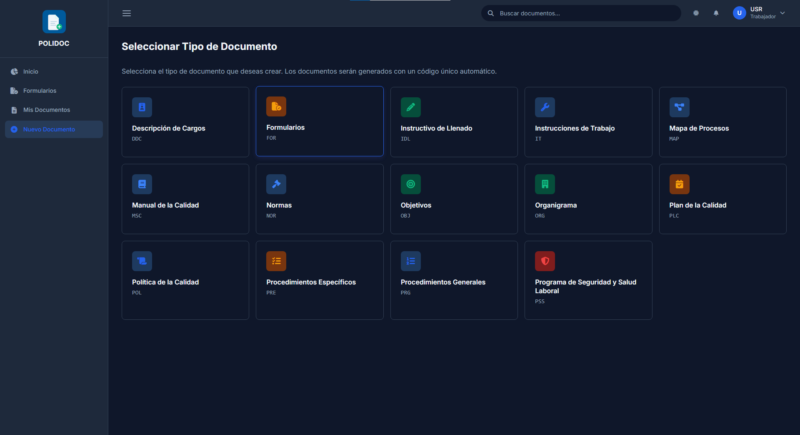
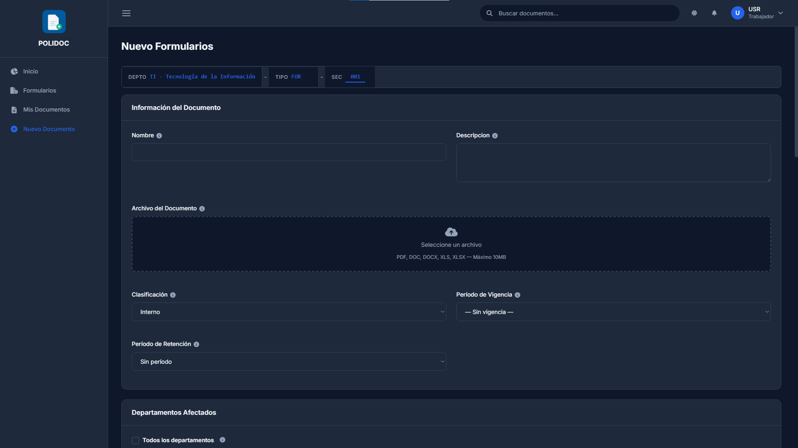

# 05. Crear un documento

## Antes de empezar

| Requisito | Qué pasa si no se cumple |
|---|---|
| Tener **departamento asignado** | "No tienes un departamento asignado. Contacta al administrador." |
| Pertenecer al rol adecuado al tipo | Algunos tipos (por ejemplo *Descripción de Procesos*) solo los crean jefes |
| Tener el archivo a subir (opcional) | Puedes guardar sin archivo, pero recibirás un aviso |

## 1. Elegir el tipo de documento

1. Menú lateral → **Nuevo Documento** (`/documentos/seleccionar-tipo/`).
2. Se muestran los tipos activos. Elige el que corresponda
   (Procedimiento General, Norma, Formulario, Instructivo, etc.).
3. Si el tipo solo lo crean jefes y no lo eres, no aparecerá en la lista.

## 2. Llenar el formulario

### Campos obligatorios

- **Nombre** del documento.
- **Clasificación** de seguridad (viene por defecto en *Interno*; revisa el
  cap. 03 antes de cambiarla).
- **Descripción de cambios** (sección *Control de Versiones*): obligatoria.
- **Período de Vigencia**, si el tipo de documento lo exige.
- Los campos marcados con **\*** del formato ISO que se aplique (si el tipo
  muestra ese bloque).

### Campos opcionales

| Campo | Para qué sirve |
|---|---|
| **Descripción** | Resumen del contenido |
| **Archivo** | Adjunto original: PDF, DOC, DOCX, XLS, XLSX o VSDX, **máximo 10 MB** (se comprueba también que el contenido real coincida con la extensión) |
| **Período de Vigencia / Retención** | Calculan automáticamente la fecha de vencimiento, retención y destrucción |
| **Departamentos Afectados** o **Todos los departamentos** | Áreas a las que aplica el documento (marcar *Todos* incluye también los departamentos futuros) |
| **Responsables (áreas)** | Departamentos responsables de su cumplimiento |
| **Participantes** | Personas o áreas involucradas (texto libre, uno por línea) |
| **Documentos Relacionados** | Otros documentos de POLIDOC con los que se relaciona |

### El código del documento

En la parte superior verás el **código** que se le asignará, por ejemplo
`TI-PRG-001` (departamento-tipo-secuencia). Es automático: solo cámbialo si
necesitas otra secuencia.

Excepción: los tipos sin prefijo de departamento (como *Descripción de
Procesos*) numeran de forma global: `DPR-001`, `DPR-002`...

## 3. Guardar

Tienes dos botones al final del formulario:

| Botón | Resultado |
|---|---|
| **Guardar Borrador** | Estado *Borrador*: solo tú (y tu jefe/administrador) lo ves. Puedes retomarlo después |
| **Enviar a Revisión** | Estado *En Revisión*: se crea la cadena de aprobación y tu jefe recibe una notificación |
| **Cancelar** | Vuelve sin guardar |

1. Revisa que no haya campos obligatorios sin llenar.
2. Pulsa el botón correspondiente.
3. Aparecerá el mensaje de confirmación y serás llevado a la ficha del
   documento.

> Si envías sin archivo adjunto, POLIDOC lo permite pero muestra
> "El documento se guardó sin archivo adjunto".

### Errores frecuentes

| Mensaje | Causa | Solución |
|---|---|---|
| "No tienes un departamento asignado" | Tu perfil no tiene departamento | Contacta al administrador |
| "Solo los jefes de departamento pueden crear este tipo de documento" | El tipo está restringido a jefes | Elige otro tipo o pide que tu jefe lo cree |
| "El código XXX ya existe. Usa otro número de secuencia" | La secuencia propuesta está tomada | Cambia el número de secuencia en el formulario |
| "Extensión no permitida" / "El archivo supera el tamaño máximo de 10 MB" | Formato o peso no admitido | Convierte el archivo a PDF o divídelo |
| "El contenido no es un PDF válido" / "no es un documento Office válido" | El contenido real no corresponde a la extensión | Vuelve a guardar el archivo desde la aplicación original |
| Aparecen errores con **\*** | No llenaste los campos obligatorios del formato ISO | Completa los campos marcados con asterisco |

## 4. Qué pasa después de enviar

Al pulsar **Enviar a Revisión** se crea una cadena de aprobación de dos pasos:

1. **Evaluación** — tu jefe de departamento (o un jefe par, si tú lo eres).
2. **Autorización** — jefe de Gerencia General.

El documento queda en *En Revisión* hasta que se resuelva. Mientras tanto
puedes ver su estado en la ficha y en la notificación. El flujo completo,
incluidos los rechazos, está en el [capítulo 06](06-aprobaciones.md).

> Si el departamento no tiene jefe asignado, el documento se guarda con un
> aviso: quedará **en espera** hasta que un administrador asigne jefe. Ese
> problema lo resuelve el administrador, no tú.

---

**Anterior:** [04. Consultar y buscar](04-consultar-y-buscar.md) ·
**Siguiente:** [06. Aprobaciones](06-aprobaciones.md)
