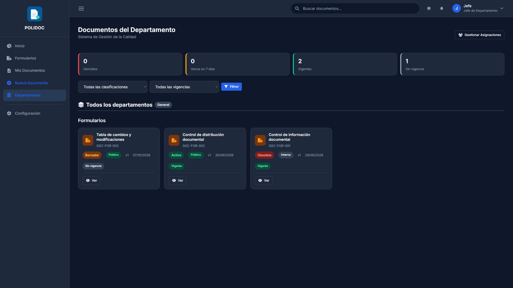
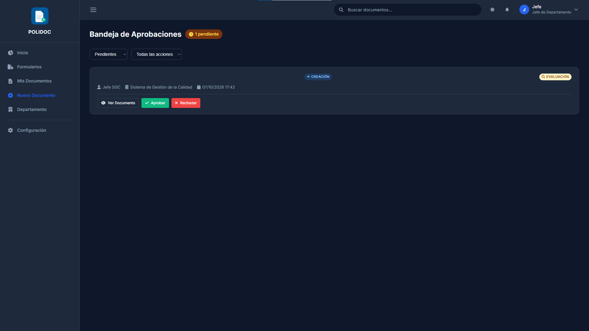
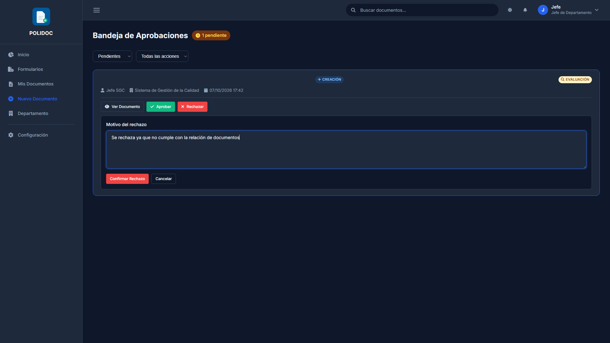

# 06. Aprobaciones: evaluación y autorización

Todos los documentos que se envían a revisión pasan por la **misma cadena de
dos pasos**. Este capítulo explica el flujo tanto para quien aprueba como para
quien espera la respuesta.

## La cadena de aprobación

```
Creador envía a revisión
        │
        ▼
┌─────────────────────┐
│ 1. EVALUACIÓN        │  Jefe de tu departamento
│    (Evaluar)         │  (si tú eres jefe, evalúa un jefe par: no te autoevalúas)
└─────────────────────┘
        │  aprobado
        ▼
┌─────────────────────┐
│ 2. AUTORIZACIÓN      │  Jefe de Gerencia General (GG)
│    (Autorizar)       │  Solo él activa el documento
└─────────────────────┘
        │  aprobado
        ▼
   Documento ACTIVO
```

- **Cualquier rechazo** detiene la cadena: el documento vuelve a *Borrador* y
  el creador recibe una notificación con el motivo.
- Son **dos pasos siempre**. Si la misma persona ocupa los dos roles, aprueba
  dos veces.
- Si falta el jefe de un paso, ese paso queda **"En espera"** hasta que un
  administrador asigne el jefe correspondiente (no se salta automáticamente).

## Estados del documento

| Estado | Significado |
|---|---|
| **Borrador** | En elaboración; solo lo ves tú, tu jefe y el administrador |
| **En Revisión** | En la cadena de aprobación |
| **Activo** | Aprobado, vigente y distribuible |
| **Obsoleto** | Vencido o inhabilitado; solo lectura histórica |



---

## Para quien aprueba (jefe de departamento / Gerencia General / administrador)

### Opción A — desde la notificación (la habitual)

1. Pulsa la **campana** y selecciona la notificación del documento.
2. Se abre la ficha del documento con el banner de aprobación.

### Opción B — bandeja de aprobaciones

La **Bandeja de Aprobaciones** lista todas tus solicitudes en una sola
pantalla. Se abre desde cualquiera de estos puntos de entrada:

- El botón **Bandeja de Aprobaciones** de la cabecera de **Menú lateral →
  Formularios** (`/documentos/`).
- El mismo botón en la cabecera de **Departamento**
  (`/documentos/departamento/`).
- La notificación de "*Aprobación estancada (+48h)*".
- Escribiendo la dirección `/documentos/bandeja-aprobaciones/`.

(No existe en el menú lateral: esos botones son el acceso normal. Solo
aparecen si eres jefe de departamento o administrador.)

La bandeja agrupa lo que debes resolver en dos secciones:

| Sección | Qué lista |
|---|---|
| **Cambios de estado** | Creación, edición, inhabilitar, reactivar, renovar, nueva versión y eliminar versión |
| **Solicitudes de Descarga** | Las descargas que te toca autorizar |

1. Abre la bandeja.
2. Usa los filtros:
   - Estado: **Pendientes** · Aprobadas · Rechazadas · Todas.
   - Acción: **Todas las acciones** · Creación · Edición · Inhabilitar ·
     Reactivar · Renovar Vencimiento · Nueva Versión · Eliminar Versión.
3. Abre la solicitud que te corresponde resolver.



> La bandeja es **la cola de lo que debes aprobar**. Para ver el estado de
> lo que *tú* has pedido usa **Mis solicitudes** (menú del usuario),
> descrita en el [capítulo 11](11-guia-trabajador-coordinador.md).

### Resolver la solicitud

En la ficha aparece el aviso **"Documento pendiente de evaluación"** o
**"Documento pendiente de autorización"** con los botones de acción:



1. **Revisa el documento.** Como aprobador puedes abrir el visor y ver el
   contenido mientras el trámite está pendiente: es necesario para evaluarlo.
2. Pulsa **Evaluar** (paso 1) o **Autorizar** (paso 2).
3. Si deseas, escribe observaciones y confirma.
4. Si apruebas en el paso 1, aparecerá *"Evaluación registrada. Pendiente de
   autorización final"* y el paso 2 pasará a *Pendiente* para Gerencia
   General.
5. Al aprobar el paso 2, el documento pasa a **Activo**, con su fecha de
   vigencia, vencimiento, revisión y versión actualizadas. El creador recibe
   una notificación.

### Rechazar

1. Pulsa **Rechazar**.
2. Escribe el **motivo del rechazo** (obligatorio; sin motivo no se envía).
3. Confirma.

El documento vuelve a **Borrador** y el creador es notificado con tu motivo.

### Errores frecuentes (aprobador)

| Mensaje | Causa | Solución |
|---|---|---|
| "El motivo de rechazo es requerido" | No escribiste el motivo | Escribe el motivo antes de confirmar |
| No ves los botones *Evaluar*/*Autorizar* | No te toca: otra persona debe resolver el paso | Espera o consulta con tu departamento |
| El documento está "En espera" | El departamento no tiene jefe asignado para ese paso | Un administrador debe asignar el jefe |
| Llega notificación "Aprobación estancada" | Más de 48 h sin resolver | Los administradores ya fueron avisados; resuelve cuanto antes |

---

## Para quien creó el documento

1. Tras enviar, la ficha muestra el estado **En Revisión** y el aviso
   *"Documento pendiente de evaluación"* o *"Documento pendiente de
   autorización"*.
2. En la pestaña **Historial de Estado** ves quién evaluó, cuándo y con qué
   observaciones.
3. Recibirás notificaciones en la campana cuando:
   - sea tu turno de corregir (rechazo),
   - o el documento sea **Activo**.
4. En **Mis Documentos** puedes filtrar por estado *En Revisión* para
   seguirlo.

### Errores frecuentes (creador)

| Mensaje | Causa | Solución |
|---|---|---|
| Documento rechazado | El aprobador pidió cambios | Lee el motivo en la notificación o en el Historial de Estado, corrige y reenvía |
| Sigue "En Espera" | Falta asignar jefe en ese paso | Contacta al administrador (no puedes resolverlo tú) |
| "No tienes permisos para ver este documento" | Ya no formas parte del flujo | Vuelve desde *Mis Documentos* |

> Los documentos ya **activos** no se editan directamente: cualquier cambio
> pasa por una Planilla de Cambios. Ver [capítulo 07](07-versionado-planilla.md).

---

## Cambios de estado: inhabilitar, reactivar y renovar

Inhabilitar un documento, reactivarlo o renovar su vencimiento son cambios
de la información documentada y, por ISO 9001:7.5.3.2, exigen **UNA sola
aprobación** y dejan evidencia (solicitud + notificación + auditoría).

### Quién aprueba

| Quién lo pide | Quién aprueba |
|---|---|
| Administrador o jefe de Gerencia General | **Nadie**: lo aplican directamente y queda registrado |
| Jefe de departamento (de cualquier departamento) | Jefe de **Gerencia General** |
| Propietario del documento | Jefe del **departamento del documento** |
| Coordinador con permiso de eliminación | Jefe del **departamento del documento** |

> Si el documento **no tiene jefe de departamento asignado**, la solicitud
> no queda en espera: se envía al jefe de **Gerencia General**. Solo queda
> en espera cuando falta el jefe de Gerencia General.

Mientras la solicitud está pendiente el documento **no cambia de estado**
(puedes seguir editándolo) y no se puede pedir otra igual para el mismo
documento.

### Inhabilitar

1. Abre la ficha del documento y pulsa **Inhabilitar** (o
   **Solicitar Inhabilitación** si te corresponde aprobar).
2. Rellena la planilla del formulario **SGC-FOR-005** si el documento tiene
   formato dinámico; es la evidencia de la disposición.
3. Confirma. Si eres administrador o jefe de Gerencia General el documento
   pasa a **Obsoleto** en el acto; en caso contrario, el aprobador recibe
   la solicitud y tú la notificación de que quedó enviada.

### Reactivar

1. En la ficha de un documento **Obsoleto** pulsa **Habilitar** (o
   **Solicitar Reactivación**).
2. Confirma. El documento vuelve a **Activo** al aprobarse.

> Si el documento obsoleto **ya venció**, la reactivación se niega: la
> única salida es **renovar** el vencimiento.

### Renovar el vencimiento

1. En la ficha de un documento **Obsoleto** (fila *Documento vencido* /
   *Documento inhabilitado* de la tarjeta ISO) pulsa
   **Reactivar / Renovar** (o **Solicitar Reactivación / Renovación**).
2. Elige la **nueva fecha** (hay atajos de +6 meses a +10 años) y añade una
   observación si quieres.
3. Confirma. Al aprobarse se fija la fecha, se limpia la cola de retención,
   el documento pasa a **Activo** y queda una *Renovación de vencimiento* en
   su historial.

### Errores frecuentes (cambios de estado)

| Mensaje | Causa | Solución |
|---|---|---|
| "Ya existe una solicitud de … pendiente" | Ya se pidió antes | Espera a que se resuelva |
| "El documento ya está inhabilitado" | Ya es obsoleto | No hay nada que hacer |
| "El documento venció el …; para reactivarlo debes solicitar una renovación" | Vencido | Usa **Renovar** en lugar de **Habilitar** |
| "No tienes permisos para solicitar la …" | No eres propietario, jefe del departamento ni coordinador con permiso | Pídeselo a quien corresponda |
| "No hay jefe de Gerencia General asignado" | El departamento GG no tiene jefe | Un administrador debe asignarlo |

---

## Eliminar una versión (solo propietario o administrador)

La eliminación de una versión **no tiene aprobación**: la ejecuta en el acto
el **propietario del documento** o un **administrador**, y queda registrada
como una fila ya aprobada (evidencia ISO). El jefe del departamento no
elimina versiones ajenas a su autoría.

1. En la ficha, pestaña **Últimas Versiones**, pulsa **Ver historial de
   versiones**.
2. Junto a la versión a quitar, pulsa **Eliminar** y confirma.
3. Si la versión eliminada era la vigente, se restaura la anterior o el
   documento pasa a *Obsoleto*.

Ver [capítulo 07](07-versionado-planilla.md) para el resto del versionado.

---

**Anterior:** [05. Crear un documento](05-crear-documento.md) ·
**Siguiente:** [07. Versionado y Planilla de Cambios](07-versionado-planilla.md)
