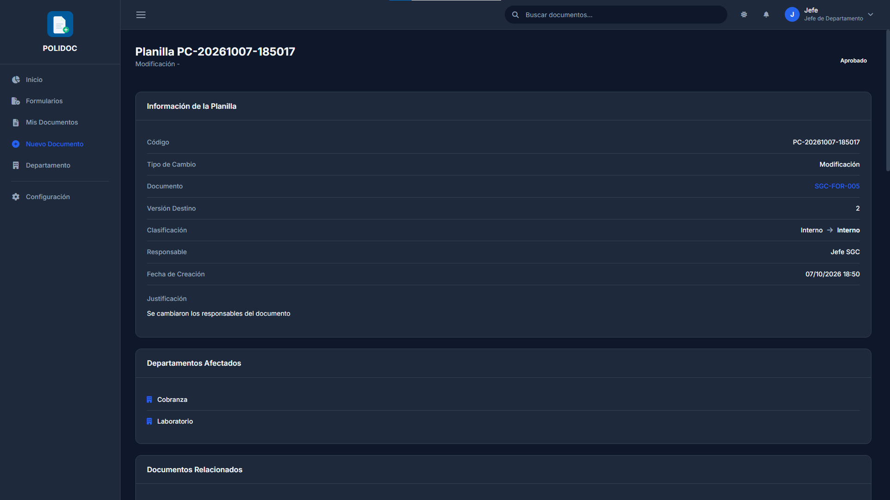
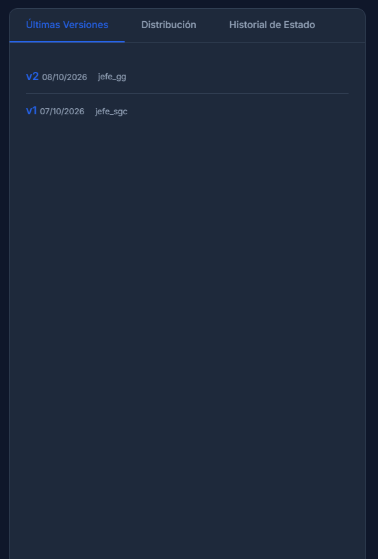

# 07. Versionado y Planilla de Cambios

## Tres contadores distintos (no los confundas)

| Contador | Qué mide | Cuándo sube |
|---|---|---|
| **Versión** | El contenido del documento (v1, v2, v3...) | Al aprobarse una Planilla de Cambios |
| **Revisión** | Ciclo ISO de revisión del documento (0, 1, 2...) | En cada activación: creación, edición o nueva versión |
| **Edición del formato** | Cambios en la plantilla/formato que se usa para llenar | Manualmente, en Configuración (administrador) |

En la ficha del documento aparecen **Versión Actual** y **Revisión** en el
bloque *Control ISO 9001:2015*.

## Editar según el estado

| Estado | Cómo se edita |
|---|---|
| **Borrador** | Botón **Editar Borrador**: formulario directo, sin aprobación |
| **En Revisión** | No se edita; se espera la resolución de la cadena |
| **Activo** | Solo mediante **Planilla de Cambios** (botón en la ficha) |
| **Obsoleto** | No se edita; se renueva o se deja como histórico |

---

## 1. Editar un borrador

1. En **Mis Documentos**, localiza el documento en estado *Borrador*.
2. Pulsa **Editar Borrador** (o el mismo botón dentro de la ficha).
3. Modifica los campos y pulsa **Guardar Borrador** o **Enviar a Revisión**.

> Solo el propietario del documento (y su jefe/administrador) puede editar.

## 2. Crear una Planilla de Cambios (documento activo)

1. Abre la ficha del documento.
2. Pulsa **Planilla de Cambios** en la cabecera.
   > Si ya tienes una planilla en borrador para ese documento, el botón aparece
   > como **Planilla de Cambios (borrador)** y te lleva a esa planilla en vez
   > de crear otra (idéntico en **Mis Documentos**).
3. Se abre el formulario (`/documentos/planilla-cambios/nueva/`).

### Campos obligatorios

- **Justificación** del cambio (por qué es necesario).
- **Nombre del Documento \***, si el nombre va a cambiar.
- **Versión destino**: la versión a la que se llegará (v2, v3...).
- Los campos marcados con **\*** del bloque *Cambios Propuestos*.

### Campos opcionales pero recomendados (ISO 9001:7.5.2)

| Campo | Contenido |
|---|---|
| **Descripción del Cambio** | Qué cambia exactamente |
| **Alcance e Impacto** | A quiénes afecta |
| **Fecha Propuesta de Implementación** | Cuándo se aplicará |
| **Criterios de Aceptación** | Cómo se sabrá que el cambio funcionó |
| **Archivo Propuesto** | Versión nueva del archivo (PDF, DOC, DOCX, XLS, XLSX, hasta 10 MB) |
| **Clasificación** | Cambia la clasificación de seguridad solo si lo marcas |
| **Documentos Asociados** | Otros documentos que deben revisarse con este cambio |

También verás el bloque **Documento Actual**, con la información vigente para
comparar.

### Guardar y enviar

| Botón | Resultado |
|---|---|
| **Guardar Borrador** | La planilla queda en borrador; puedes retomarla (ver abajo) |
| **Enviar a Revisión** | Se crea la cadena de aprobación (Autorizador si eres jefe; Evaluador → Autorizador si no lo eres) |
| **Cancelar** | Vuelve sin guardar |

### Retomar un borrador

Guardar borrador **no bloquea el documento** (sigue activo), así que puedes
volver a él más tarde. Hay tres formas de encontrarlo:

1. En la **ficha del documento**, el botón de la cabecera pasa a llamarse
   **Planilla de Cambios (borrador)** y abre esa planilla.
2. En **Mis Documentos**, la tarjeta del documento muestra el mismo botón
   **Planilla de Cambios (borrador)**.
3. En el detalle de la planilla (`/documentos/planilla-cambios/<código>/`),
   el aviso azul tiene los botones **Continuar edición** (abre el formulario
   con todo lo guardado) y **Enviar a Revisión**.

Solo el **responsable** de la planilla puede retomarla; una vez enviada a
revisión deja de ser editable (habrá que esperar a la aprobación o al
rechazo).

La planilla pasa por la misma cadena que el documento: **un solo paso**
(**Autorización** por Gerencia General) si el responsable es un **jefe de
departamento**, y **dos pasos** (**Evaluación** del jefe y **Autorización**
de Gerencia General) para el resto. Los aprobadores la encuentran en la
**Bandeja de Aprobaciones** y en la campana.

## 3. Qué ocurre al aprobar la planilla

1. La planilla pasa a **Aprobada**.
2. El documento obtiene la **nueva versión** y la **revisión** actualizada.
3. Se registra una entrada en el **Historial de Versiones** con quién la creó
   y qué cambió.
4. Si se adjuntó un archivo propuesto, pasa a ser el archivo vigente.
5. Quien distribuyó el documento recibe la notificación de **nueva versión**.
6. En el bloque **Formularios SGC** de la ficha aparecen los formularios de
   control generados, con opción de **Exportar PDF**.

Si la planilla se **rechaza**, el documento queda como estaba y el responsable
recibe el motivo.

> **Mientras la planilla está en revisión, el documento aparece como
> *En Revisión*** (ya no figura como activo). Si la planilla se rechaza, el
> documento **vuelve a *Activo*** tal como estaba; si se aprueba, se aplica la
> nueva versión.

## 4. Historial de versiones

1. Abre la ficha del documento.
2. En el bloque de versiones, pulsa **Historial**
   (`/documentos/<tipo>/<uuid>/versiones/`).
3. Verás cada versión con su número, fecha, quién la creó, sus cambios y el
   archivo correspondiente. La versión vigente aparece como **Actual**.

### Eliminar una versión

1. En el historial, pulsa **Eliminar** junto a la versión a quitar y
   confirma.
2. Quién puede (no hay aprobación: se ejecuta en el acto y queda registrada
   como evidencia ISO):
   - **Propietario del documento** o **administrador**.
   - El jefe del departamento, por sí solo, **no** elimina versiones ajenas a
     su autoría.
3. Si la versión eliminada era la vigente, se restaura la anterior o el
   documento pasa a *Obsoleto*.

### Errores frecuentes

| Mensaje | Causa | Solución |
|---|---|---|
| "No tienes permisos para eliminar esta versión" | No eres el propietario ni administrador | Pídeselo al propietario o a un administrador |
| No aparece el botón **Eliminar** | No eres propietario ni administrador | Solo ellos ven el botón |
| "No tienes permisos para editar este documento" | Solo el propietario (o quien tenga asignación de edición) edita | Revisa tus asignaciones |
| No aparece el botón *Planilla de Cambios* | El documento está en borrador | Usa *Editar Borrador* |
| No encuentras tu planilla borrador | No hay un listado de planillas; solo se reabre por su enlace | Botón **Planilla de Cambios (borrador)** en la ficha o en Mis Documentos (§2) |
| "No se encontró una planilla en borrador tuya con ese identificador" | No eres el responsable o la planilla ya no está en borrador | Solo el responsable puede retomarla; si ya fue enviada, espera la respuesta |

---

**Anterior:** [06. Aprobaciones](06-aprobaciones.md) ·
**Siguiente:** [08. Descargas y distribución](08-descargas-distribucion.md)
