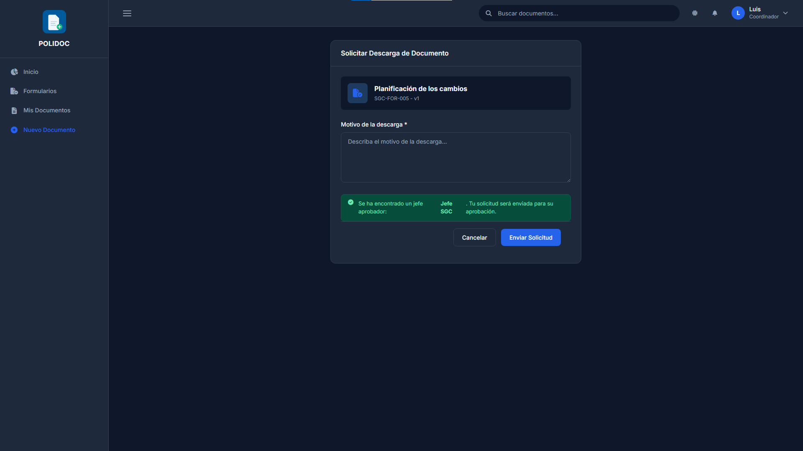

# 08. Descargas, distribución y trazabilidad

POLIDOC no descarga "libremente": cada descarga de un documento controlado
está **autorizada**, **limitada en el tiempo** y **registrada** (ISO 9001:7.5.3
e ISO 15489).

## 1. Cuándo puedes descargar directamente

| Clasificación | Descarga directa | Si no te corresponde |
|---|---|---|
| **Público** | Todos | — |
| **Interno** | Jefe del departamento, propietario, quien tenga distribución vigente | Botón **Solicitar Descarga** |
| **Confidencial** | Administrador, quien tenga distribución vigente | Solicitud con aprobación del jefe |
| **Restringido** | Administrador, quien tenga distribución vigente | Solicitud con **doble control**: jefe + administrador |
| Cualquier caso | Si ya tienes una **autorización vigente** | — |

- Si puedes descargar, verás el botón **Descargar** en la ficha.
- Si no, verás **Solicitar Descarga** (o el aviso *"Solicitud pendiente de
  aprobación"* si ya la pediste).

## 2. Solicitar la descarga

1. Llega al formulario de solicitud de dos formas:
   - Desde la **ficha** del documento, con el botón **Solicitar Descarga**.
   - Desde el **catálogo** (Menú lateral → Formularios, cap. 04), con el
     botón **Solicitar** de la tarjeta: ahí están todos los formularios
     activos, aunque todavía no tengas acceso a ellos.
2. Escribe el **Motivo de la descarga \*** (obligatorio: justifica para qué
   necesitas el archivo).
3. Pulsa **Enviar Solicitud**. Aparecerá *"Solicitud de descarga enviada
   correctamente"*

La solicitud llega a tu **jefe de departamento** (notificación en la campana).
Si el documento es **Restringido**, además llegará al administrador: hacen
falta las dos aprobaciones.

### Errores frecuentes

| Mensaje | Causa | Solución |
|---|---|---|
| "Ya tienes permiso para descargar este documento" | No necesitas solicitar | Vuelve a la ficha y pulsa *Descargar* |
| "Ya tienes una solicitud pendiente para este documento" | Ya la pediste | Espera la respuesta del jefe |
| "Ya tienes una descarga aprobada. Usa el botón Descargar" | Tu autorización sigue vigente | Pulsa *Descargar* |
| "No se puede realizar la solicitud en este momento. Comuníquese con el administrador" | El departamento no tiene jefe ni administrador asignado | Contacta al administrador |

## 3. Aprobar o rechazar la solicitud (jefe de departamento)

1. Entra por la **campana** (la notificación enlaza directo) o por el botón
   **Bandeja de Aprobaciones** de la cabecera de Formularios o de
   Departamento (también `/documentos/bandeja-aprobaciones/`), que lista las
   solicitudes de descarga junto con las demás. La pantalla se titula
   **"Aprobar Solicitud de Descarga"**.
2. Revisa el documento solicitado y su motivo; puedes abrirlo en el visor
   para evaluar.
3. Pulsa **Aprobar** (con *Observaciones (opcional)*) o **Rechazar**.
4. En documentos **Restringidos** verás el mensaje *"Evaluación registrada.
   Pendiente de autorización final"*: falta que el administrador autorice.

Al aprobarse definitivamente, el solicitante recibe la notificación y el
botón **Descargar**.

## 4. Vigencia de la autorización

Una solicitud aprobada **no es para siempre**:

| Regla | Detalle |
|---|---|
| **Caduca a los 30 días** | Desde la fecha de aprobación |
| **Es por versión** | Si el documento sube de versión, la autorización deja de servir y hay que solicitar de nuevo |
| **Queda registrada** | Quién aprobó, cuándo, qué versión y hasta cuándo |

Si la autorización venció o cambió la versión, volverás a ver el botón
**Solicitar Descarga**.

## 5. Distribución de copias (jefe, propietario o administrador)

La **distribución** entrega una copia controlada del documento a usuarios
concretos, que pasan a verlo y descargarlo hasta que se revoque.

1. En la ficha del documento activo, pulsa **Distribuir**.
2. Selecciona los **destinatarios** (mínimo uno) y el **método**
   (Sistema, Email o Impreso).
3. Añade observaciones si quieres y confirma.
4. Cada destinatario recibe una notificación.

Consultas y cambios desde la ficha:

- Pestaña **Distribución**: quién recibió la copia, cuándo, por cuál método y
  si el correo se envió bien.
- **Historial de Distribución**: registro completo, incluidas las revocadas.
- **Revocar**: corta el acceso; el usuario deja de ver y descargar el
  documento. Puede hacerlo el administrador, el jefe del departamento y el
  propietario. Queda registrado con motivo.

### Errores frecuentes

| Mensaje | Causa | Solución |
|---|---|---|
| "Solo se pueden distribuir documentos activos" | El documento no está aprobado | Apruébalo o actívalo primero |
| "Debes seleccionar al menos un destinatario" | No elegiste a nadie | Selecciona al menos un usuario |
| "No tienes permisos para distribuir este documento" | No eres jefe de ese departamento, ni propietario, ni administrador | Pide que lo distribuya quien corresponda |

## 6. Transferir la propiedad

Cambia el propietario del documento (para cuando una persona se va de área).

1. En la ficha, pulsa **Transferir**.
2. Elige al nuevo propietario: **debe pertenecer al mismo departamento** del
   documento.
3. Confirma: el nuevo propietario es notificado y asume la responsabilidad
   del documento.

Pueden transferir: el **jefe del departamento** del documento y el
**administrador**. La transferencia es directa (no requiere aprobación).

## 7. Qué queda registrado

Toda descarga, visualización en el visor, aprobación, distribución,
transferencia y eliminación genera un **registro de auditoría** con usuario,
fecha, IP y el documento afectado; los registros están encadenados y protegidos
para que no se puedan alterar (ISO 15489).

**Consecuencia práctica:** si la auditoría no está disponible, el sistema
**bloquea la entrega de documentos controlados** en lugar de dejar el registro
sin escribir. Verás entonces:

> "No se pudo registrar la auditoría de la descarga. Por seguridad, la
> descarga queda bloqueada; contacte al administrador."

o, en el visor:

> "No se pudo registrar la auditoría de la consulta. Por seguridad, la
> visualización queda bloqueada; contacte al administrador."

En ambos casos, contacta al administrador (ver
[capítulo 09](09-troubleshooting.md)).

La consulta de esos registros y el reporte PDF corresponden al rol de
administrador (Tomo 2).

---

**Anterior:** [07. Versionado y Planilla de Cambios](07-versionado-planilla.md) ·
**Siguiente:** [09. Solución de problemas](09-troubleshooting.md)
