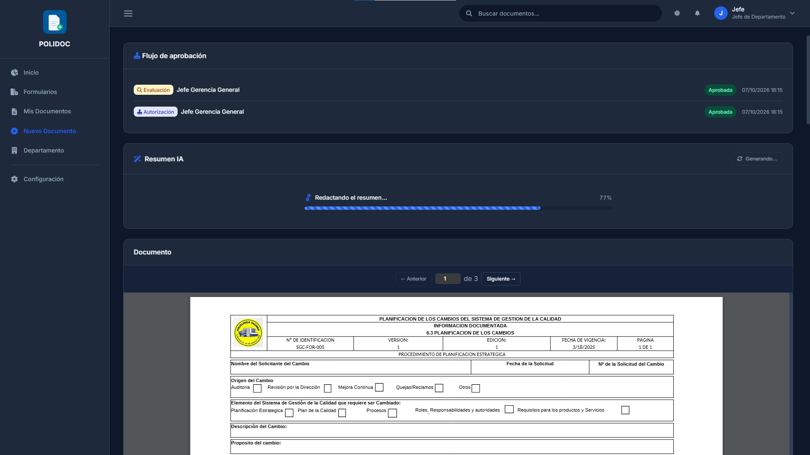

# 11. Guía del trabajador y del coordinador

Resumen de todo lo que puede hacer un **trabajador** y un **coordinador**
en POLIDOC, con enlaces al capítulo detallado de cada flujo.

## Tu cuenta y tu panel

1. Entra con tu usuario institucional ([capítulo 02](02-primeros-pasos.md)).
2. **Inicio** (`/inicio/`) muestra tus documentos recientes, avisos de
   vencimiento y notificaciones.
3. **Mi Perfil** (`/perfil/`) permite cambiar tu foto, tu firma y tus
   datos de contacto. El rol, el departamento y la contraseña los asigna
   el administrador: si algo está mal, pídele la corrección.

## Trabajador

### Consultar y buscar

- **Mis Documentos** (`/documentos/mis-documentos/`): tus documentos con
  filtros de estado, clasificación y vigencia.
- **Catálogo / Formularios Descargables** (`/documentos/`): plantillas
  oficiales que puedes bajar directamente.
- **Buscador del navbar**: autocompletado por nombre, código y
  participantes.
- En la ficha de cualquier documento activo puedes ver el visor PDF y, si
  está habilitado, generar el **Resumen IA**.

### Crear y editar tus documentos

1. **Documentos → Crear** y elige el tipo
   ([capítulo 05](05-crear-documento.md)).
2. Rellena el formulario (los campos obligatorios van marcados con *).
3. Elige **Guardar borrador** o **Enviar a Revisión**.
4. Si te rechazan una creación o una Planilla de Cambios, lee el motivo y
   corrige.

### Pedir cambios en documentos

| Quieres… | Cómo | Capítulo |
|---|---|---|
| Editar un documento activo tuyo | Planilla de Cambios desde la ficha | 07 |
| Inhabilitar / reactivar / renovar un documento tuyo | Botón en la ficha (te lo aprueba el jefe del departamento) | 06 |
| Eliminar una versión | Historial de versiones (solo si eres propietario o admin) | 07 |
| Descargar un documento que no es tuyo | **Solicitar Descarga** con motivo | 08 |

### Lo que un trabajador no puede hacer

- Editar documentos de otros ni documentos activos directamente.
- Aprobar nada (creaciones, planillas, descargas, cambios de estado).
- Ver el panel **Departamento** ni la **Configuración**.

## Coordinador

Un coordinador es un trabajador al que el jefe le **asigna documentos**
con permisos concretos:

| Permiso de la asignación | Te permite |
|---|---|
| **Leer** | Ver el documento aunque no seas el propietario |
| **Editar** | Editar borradores y crear Planillas de Cambios |
| **Eliminar** | Eliminar el documento; además puedes **inhabilitar, reactivar y renovar** (te lo aprueba el jefe del departamento) |

1. Los documentos asignados aparecen junto a los tuyos en **Mis
   Documentos**.
2. Los permisos que te dio el jefe están en la ficha de cada documento
   asignado (tarjeta *Asignaciones*).
3. Si te faltan permisos, pídeselos al jefe: él decide al asignar.

> El coordinador **no** aprueba nada: las aprobaciones siguen siendo del
> jefe. Ver [capítulo 12](12-guia-jefe-departamento.md).

### Errores frecuentes

| Mensaje | Causa | Solución |
|---|---|---|
| "No tienes permisos para acceder a esta sección" | La sección es de jefes o admin | Vuelve a Mis Documentos |
| "No tienes un departamento asignado" | Tu perfil no tiene departamento | Pide al administrador que te asigne |
| No ves el botón de editar en un documento asignado | Tu asignación es solo de lectura | Pide permiso de edición al jefe |
| No puedes inhabilitar un documento asignado | Tu asignación no tiene permiso de eliminación | Pídeselo al jefe o al propietario |
| No aparece un documento en Mis Documentos | No es tuyo ni está asignado | Usa el buscador o pide acceso al jefe del departamento |

---

**Anterior:** [10. Vigencia y vencimientos](10-vigencia-y-vencimientos.md) ·
**Siguiente:** [12. Guía del jefe de departamento](12-guia-jefe-departamento.md)
