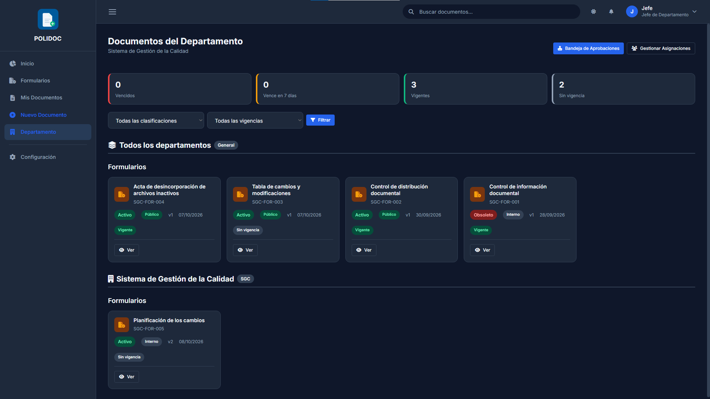
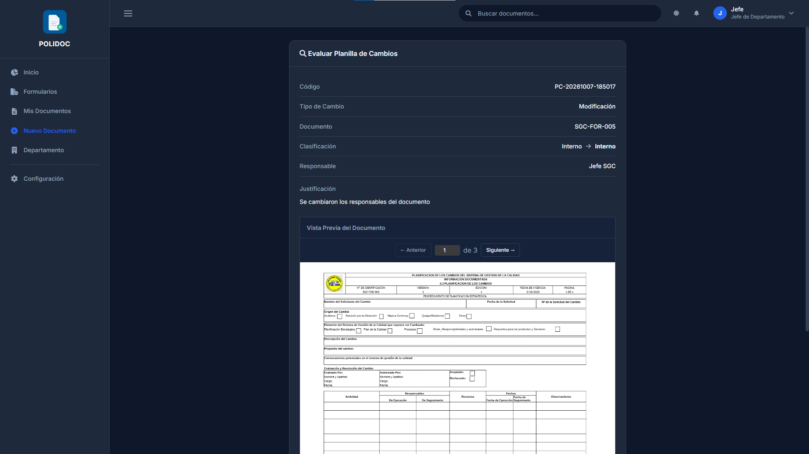
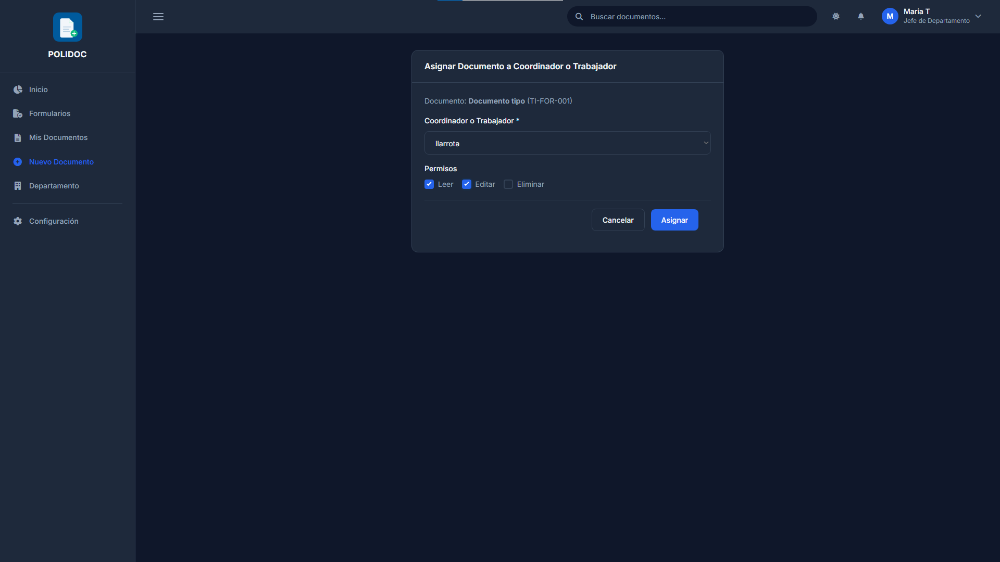
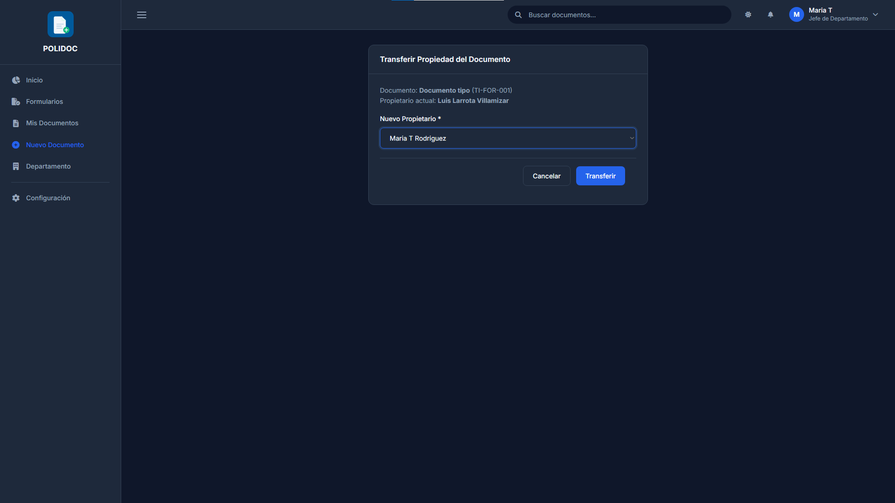
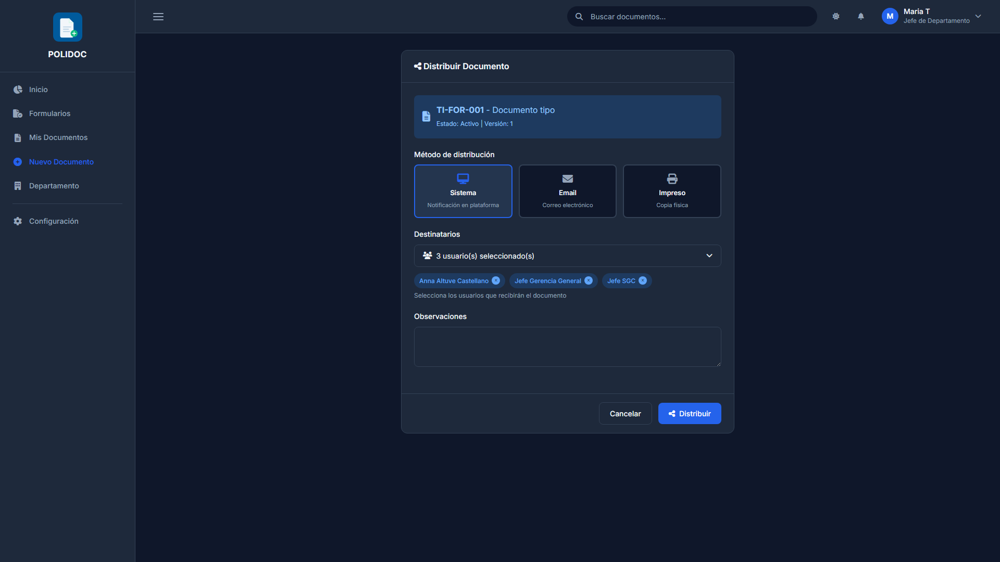

# 12. Guía del jefe de departamento

El **jefe de departamento** es la autoridad operativa de sus documentos:
aprueba, asigna, distribuye y controla su vigencia. Los flujos detallados
están en los capítulos 06, 07, 08 y 10; aquí va el resumen de tu trabajo.

## Las mismas tarjetas en Inicio

Entra a **Inicio** (`/inicio/`): bajo las estadísticas verás la tarjeta
**"Vigencia del departamento"**, con los mismos cuatro conteos del panel
Departamento (vencidos, vence en 7 días, vigentes y sin vigencia).

Cada tarjeta abre **Departamento** ya filtrada por esa vigencia, para que
pases directo a lo que urge. Solo tú, como jefe, ves esta tarjeta; tus
coordinadores y trabajadores no la ven.

## El panel Departamento

Entra a **Departamento** (`/documentos/departamento/`): es tu vista de
control.

| Elemento | Para qué |
|---|---|
| **Tarjetas de conteo** | Vencidos, vence pronto, vigentes y sin vigencia |
| **Filtro de vigencia** | Ver solo lo que urge |
| **Filtro de clasificación** | Público, interno, confidencial, restringido |
| **Grupos** | Documentos por departamento afectado (y los de "todos los departamentos") |
| **Solicitudes de descarga** | Las que esperan tu respuesta |

> Como jefe ves **tu departamento**. El administrador, desde el mismo
> panel, ve todos los departamentos.

## Aprobar

Como jefe resuelves los flujos de aprobación (detallados en el
[capítulo 06](06-aprobaciones.md)):

1. **Evaluación** de creaciones y Planillas de Cambios que envían los
   **trabajadores y coordinadores** de tu departamento (y de lo que la
   bandeja te asignó como evaluador). **Los jefes no pasan por evaluación**:
   su envío va directo a autorización.
2. **Autorización** si eres el jefe de **Gerencia General**: es el único
   paso de lo que envían los demás jefes, y también de tus propios documentos
   y planillas, que aparecen como **tarea pendiente a tu nombre**.
3. **Solicitudes de descarga** de los documentos de tu departamento.
4. **Cambios de estado** (inhabilitar, reactivar, renovar) de los
   documentos de tu departamento cuando los pide el propietario o un
   coordinador con permiso.

Si tú mismo pides un cambio de estado de **tu** departamento, lo aprueba
el jefe de **Gerencia General**; si lo pide un jefe de otro departamento,
también lo aprueba Gerencia General. Tú nunca te apruebas a ti mismo en los
cambios de estado (esa regla no cambia).

## Gestionar a tu gente

### Asignar documentos a un coordinador

1. En la ficha del documento, pulsa **Asignar**.
2. Elige al coordinador y marca sus permisos: **leer**, **editar**,
   **eliminar**.
3. Confirma: el coordinador recibe una notificación y el documento aparece
   en su Mis Documentos.

### Asignar un departamento a un usuario

La asignación de departamento a un usuario la hace el **administrador**
([capítulo 13](13-guia-administrador.md)); tú solo pides la corrección si
alguien está mal ubicado.

### Transferir propiedad

1. En la ficha, pulsa **Transferir**.
2. Elige al nuevo propietario: debe ser del **mismo departamento**.
3. Confirma: el nuevo propietario pasa a ser responsable del documento.

### Distribuir copias controladas

1. En la ficha, pulsa **Distribuir**.
2. Elige quién recibe la copia y hasta cuándo es válida.
3. El destinatario ve el documento como si fuera suyo para lectura, y tú
   puedes **revocar** la distribución cuando quieras.

## Vigencia de tu departamento

1. En la ficha de cualquier documento activo, usa la tarjeta ISO para
   **establecer, cambiar o quitar** la vigencia ([capítulo 10](10-vigencia-y-vencimientos.md)).
2. En el panel Departamento, controla con los filtros y las tarjetas qué
   vence pronto.
3. Los documentos obsoletos de tu departamento se recuperan con
   **Renovar el vencimiento** ([capítulo 06](06-aprobaciones.md)).

## Configuración y auditoría

Como jefe puedes **ver** (no editar):

- **Períodos de vigencia** y **tipos de documento**
  (`/documentos/configuracion/`).
- La **matriz de roles y permisos**, incluida quién es el jefe de Gerencia
  General (el único aprobador de lo que envían los jefes).
- La **auditoría de tus propias acciones**
  (`/documentos/configuracion/auditoria/`): el sistema te muestra solo tus
  propios registros. Ver [capítulo 14](14-auditoria-e-informes.md).

Crear y editar períodos, tipos, departamentos, formatos y usuarios es
exclusivo del administrador ([capítulo 13](13-guia-administrador.md)).

### Errores frecuentes

| Mensaje | Causa | Solución |
|---|---|---|
| "No tienes permisos para acceder a esta sección" | Entraste a Configuración con una sección de solo admin | Usa las secciones de lectura o pide al admin |
| "No tienes un departamento asignado" | Tu perfil no tiene departamento | Un administrador debe asignarlo |
| No puedes resolver una aprobación | No es tu turno (evaluación vs. autorización) | Espera o revisa la bandeja |
| Un documento tuyo no aparece en Departamento | El filtro de vigencia/clasificación lo excluye | Limpia los filtros |
| "El usuario debe pertenecer al mismo departamento" (transferir) | Elegiste a alguien de otro departamento | Transfiere solo dentro del departamento |
| No ves la auditoría de tus compañeros | Los jefes ven solo sus propios registros | Solo el administrador ve todo |

---

**Anterior:** [11. Guía del trabajador y del coordinador](11-guia-trabajador-coordinador.md) ·
**Siguiente:** [13. Guía del administrador](13-guia-administrador.md)
