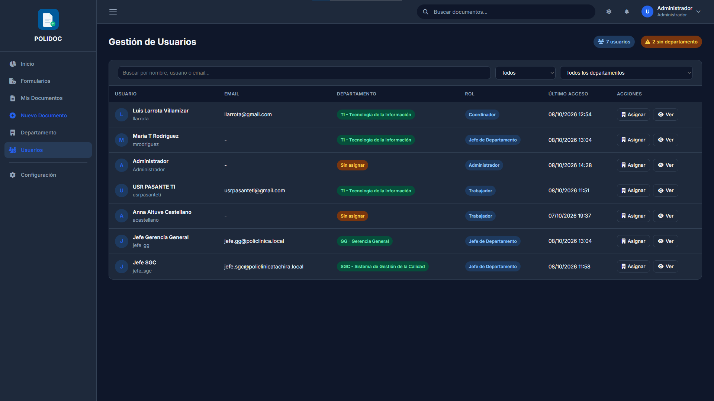
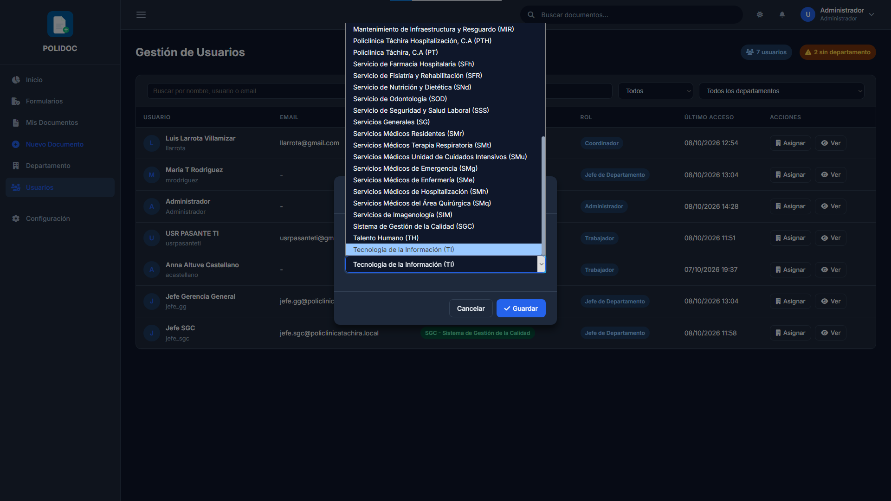
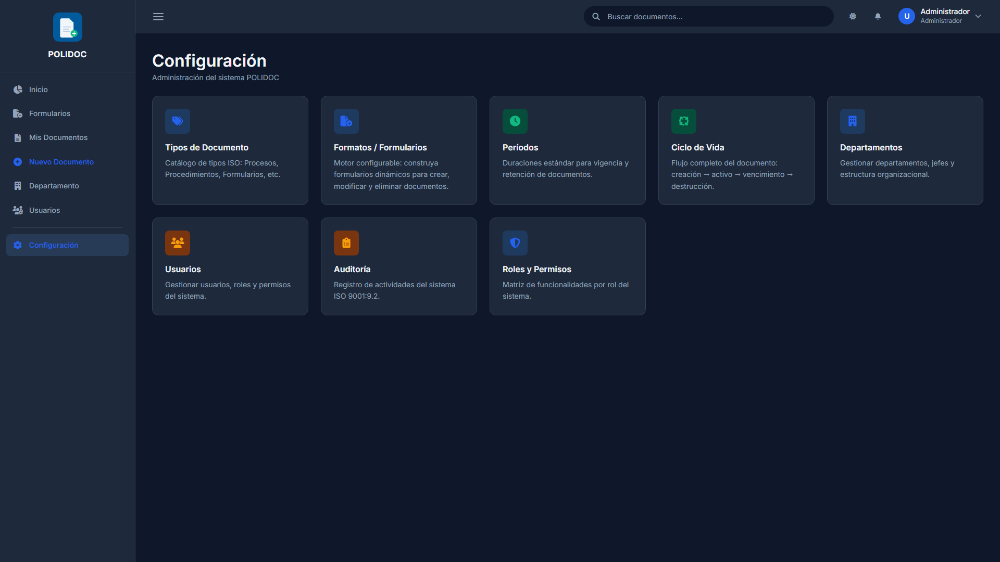
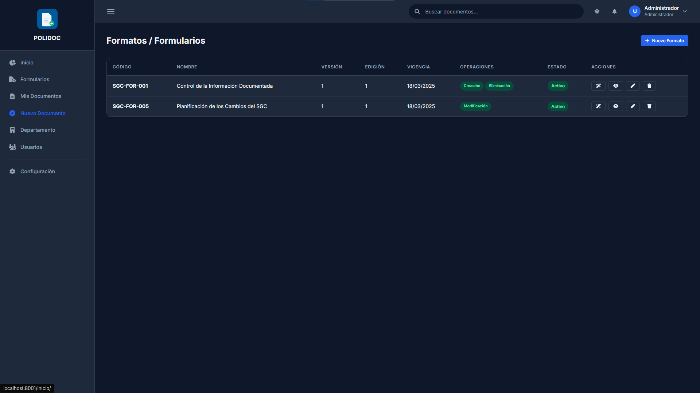
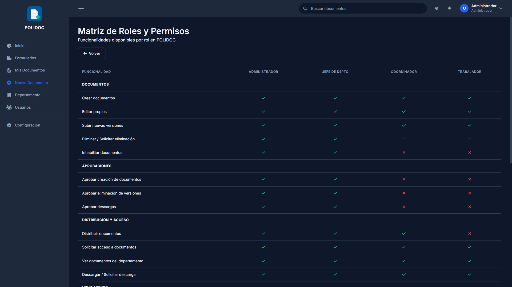

# 13. Guía del administrador

El **administrador** tiene acceso total: usuarios, catálogos, formatos,
auditoría y la capacidad de aplicar cambios de estado sin aprobación.

## Usuarios

Entra a **Usuarios** (`/usuarios/`).

1. **Busca** por usuario, nombre o correo.
2. Filtra por departamento o por estado (*sin departamento* / *con
   departamento*).
3. Pulsa un usuario para ver su detalle: documentos, notificaciones y
   actividad.
4. **Asignar departamento:** desde el usuario (o con el modal de la
   lista), elige el departamento y guarda. Es la única forma de ubicar a
   un usuario en un departamento: el sistema lo sincroniza con el
   directorio activo al iniciar sesión, pero la asignación la haces tú.

> Los usuarios **no se crean ni se borran** aquí: nacen y mueren en el
> directorio activo (LDAP). POLIDOC solo los asigna a departamentos y
> muestra su estado.

## Configuración

Entra a **Configuración** (`/documentos/configuracion/`). El jefe de
departamento ve estas secciones en modo lectura; crear y editar es de
solo administrador.

### Departamentos

`Configuración → Departamentos`: alta, edición, desactivación y
reactivación de departamentos. Cada departamento tiene un **jefe**, que es
quien aprueba sus documentos.

### Períodos de vigencia

`Configuración → Períodos de Vigencia`: crea los períodos en meses que los
documentos usarán (6 meses, 1 año, 2 años…). Ver
[capítulo 10](10-vigencia-y-vencimientos.md).

### Tipos de documento

`Configuración → Tipos de Documento`: cada tipo define el código y el
prefijo con que se numeran los documentos, su icono y color, y estas
opciones importantes:

| Opción | Efecto |
|---|---|
| **Período de vigencia por defecto** | El formulario de creación lo trae precargado |
| **Requiere vigencia** | La vigencia es obligatoria y no se puede quitar |
| **Solo jefes** | Solo los jefes de departamento pueden crear documentos de ese tipo |
| **Prefijo sin departamento** | El código no lleva el prefijo del departamento |

### Formatos (constructores de planillas)

`Configuración → Formatos`: los formularios dinámicos que se usan como
planillas (creación, Planilla de Cambios, SGC-FOR-001 de inhabilitación).

1. **Nuevo formato:** código, nombre y a qué proceso aplica
   (*aplica creación*, *aplica edición*, etc.).
2. **Constructor:** crea **secciones** y, dentro de cada una, **campos**
   (texto, número, fecha, casilla, selección…), con orden y si son
   obligatorios.
3. **Preview** y **Publicar:** revisa el resultado antes de ponerlo en
   circulación; un formato borrador no aparece en los formularios.
4. **Desactivar / Reactivar:** retíralo del circuito sin perder su
   historial.

### Roles y permisos

`Configuración → Roles y Permisos`: la matriz de referencia de quién puede
hacer qué, y el **departamento clave** del modelo de aprobación:

- **Gerencia General** (código `GG`): su jefe es el **único aprobador** de
  lo que envían los jefes de departamento (creación y Planillas de Cambios),
  y el autorizador final del resto de flujos. También aprueba los cambios de
  estado que piden los jefes.

### Ciclo de vida

`Configuración → Ciclo de Vida`: el diagrama de los estados del documento
(borrador → en revisión → activo → obsoleto) y de las transiciones con
aprobación.

## Administrar documentos

| Acción | Cómo | Notas |
|---|---|---|
| **Aplicar cambios de estado** | Botones de la ficha | Inhabilitar, reactivar y renovar se aplican **directo**, sin aprobación, y quedan auditados |
| **Eliminar versiones** | Historial de versiones | Directo, como el propietario |
| **Ajustar vigencia** | Tarjeta ISO | Como propietario o jefe |
| **Destruir documentos** | Ficha de un documento **obsoleto** cuya fecha de destrucción ya pasó | Requiere **superusuario**; se pide confirmación escribiendo el código |

> La destrucción es el fin del ciclo de retención: elimina el archivo y sus
> versiones para siempre. Aparece solo cuando el documento es obsoleto y
> venció su período de retención.

## Auditoría

El administrador tiene acceso completo a la auditoría y a los informes:
[capítulo 14](14-auditoria-e-informes.md).

### Errores frecuentes

| Mensaje | Causa | Solución |
|---|---|---|
| "No tienes permisos para acceder a esta sección" | Entraste sin sesión de administrador | Inicia sesión con tu cuenta de admin |
| Un usuario no aparece en la lista | Solo se listan los usuarios del directorio activo | Crea o habilita la cuenta en el directorio |
| "Solo los administradores pueden crear períodos / formatos / departamentos" | Esas acciones son de solo admin | Usa el formulario correspondiente, no el de solo lectura |
| "Solo se pueden destruir documentos obsoletos" | El documento no es obsoleto | Inhabílitalo primero y espera el fin de la retención |
| "Este documento aún no es elegible para destrucción" | Falta el fin de la retención | Espera a la fecha de destrucción |
| Un formato no aparece al crear documentos | Está en borrador o desactivado | Publícalo o reactívalo desde Formatos |
| No ves registros de auditoría | MongoDB no está disponible | Contacta al área de TI; la lista lo indica |

---

**Anterior:** [12. Guía del jefe de departamento](12-guia-jefe-departamento.md) ·
**Siguiente:** [14. Auditoría, trazabilidad e informes](14-auditoria-e-informes.md)
