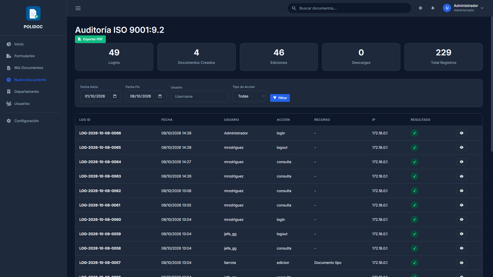
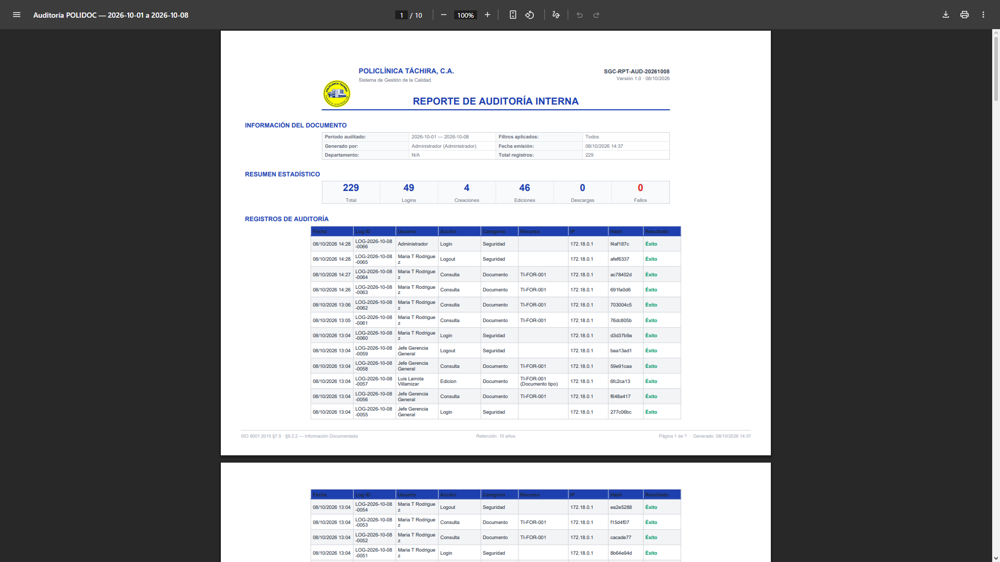

# 14. Auditoría, trazabilidad e informes

POLIDOC registra cada acción relevante con **quién, cuándo, desde dónde y
con qué resultado**: es la evidencia de trazabilidad que pide la norma
ISO 9001:7.5.3.2. Este capítulo explica cómo consultarla y exportarla.

## Qué se audita

| Categoría | Ejemplos |
|---|---|
| **Acceso** | Inicio y cierre de sesión |
| **Documentos** | Creación, edición, nueva versión, eliminación de versión |
| **Estado** | Inhabilitación, reactivación, renovación, cambio de vigencia |
| **Aprobaciones** | Evaluación, autorización, rechazos (con el motivo) |
| **Descargas y distribución** | Descargas directas, solicitudes, distribuciones y revocaciones |
| **Administración** | Usuarios, departamentos, catálogos, formatos, destrucción |

Cada registro guarda la **IP de origen** y el **agente de usuario**
(navegador), además del usuario, la acción, el recurso afectado y el
resultado (exitoso o no).

## Quién puede ver la auditoría

| Rol | Alcance |
|---|---|
| **Administrador** | Todos los registros; puede filtrar por cualquier usuario |
| **Jefe de departamento** | Solo **sus propios** registros (el filtro de usuario se fija solo) |
| Los demás | No tienen acceso |

## Consultar los registros

1. Entra a **Configuración → Auditoría**
   (`/documentos/configuracion/auditoria/`).
2. Ajusta los filtros:
   - **Fecha:** por defecto, los últimos 7 días.
   - **Usuario** (solo el administrador puede elegir otro).
   - **Tipo de acción** (login, creación, edición, descarga…) y
     **categoría** (vencimiento, aprobación…).
3. Revisa las **estadísticas** del período: inicios de sesión, creaciones,
   ediciones y descargas.
4. Pulsa un registro para ver su **detalle completo** (IP, agente,
   detalles en JSON).

> La auditoría vive en MongoDB. Si el servidor no está disponible, la
> pantalla lo indica y no se muestran registros.

## Exportar el reporte PDF

1. En la misma pantalla, pulsa **Exportar PDF**
   (`/documentos/configuracion/auditoria/reporte-pdf/`).
2. El sistema genera un PDF con el encabezado del SGC, el período
   consultado, las estadísticas y la tabla de registros (con paginación
   del reporte, no la de la pantalla).

> El reporte refleja **los filtros aplicados en pantalla**: si quieres el
> informe de un mes, ajusta primero el rango de fechas.

## Historial de reportes

Cada PDF que exportas **queda guardado** en el servidor con un código único
(`SGC-RPT-AUD-<fecha>-<hora>-<id>`), el período cubierto, los filtros
aplicados, el total de registros y un **hash SHA-256** que permite demostrar
que el informe no fue alterado después de generarlo
(ISO 15489 §6.5 · ISO 27001 A.12.4).

Para consultarlo:

1. Entra a **Configuración → Reportes de Auditoría**
   (`/documentos/configuracion/auditoria/reportes/`), o usa el botón
   **Historial de reportes** que aparece junto a *Exportar PDF*.
2. Revisa la tabla: código, período, cantidad de registros, quién lo generó,
   fecha, tamaño y hash.
3. Pulsa **Descargar** para volver a obtener el PDF, tal como se generó.

> Los informes se guardan en una **carpeta privada del servidor**, fuera de
> los archivos públicos: no se pueden abrir con una dirección web directa.
> Solo el **administrador** ve el historial y descarga; los jefes de
> departamento generan reportes, pero no tienen acceso al historial.

Los informes se eliminan solos al cumplir **10 años** de generados, según la
retención documental. El código también queda registrado en la auditoría
(acción `reporte_auditoria`).

## Otras fuentes de trazabilidad

- **Historial de Estado** de cada documento (pestaña de su ficha): quién
  evaluó y autorizó, cuándo y con qué observaciones.
- **Historial de versiones**: cada versión con su archivo y su autoría.
- **Renovaciones de vencimiento**: cada renovación queda como fila en la
  ficha del documento.
- **Notificaciones**: el historial de lo que se notificó a cada usuario.

### Errores frecuentes

| Mensaje | Causa | Solución |
|---|---|---|
| "No tienes permisos para acceder a auditoría" | No eres jefe ni admin | Pide el reporte a quien corresponda |
| La lista sale vacía | No hay registros en el rango o MongoDB está caído | Amplía el rango; si el aviso de MongoDB aparece, contacta a TI |
| No puedes filtrar por otro usuario | Eres jefe: el filtro se fija en ti | Solo el administrador ve registros ajenos |
| El PDF no coincide con lo que ves | Los filtros de la pantalla cambiaron | Vuelve a aplicar el rango y exporta de nuevo |
| No aparece un informe antiguo en el historial | Ya superó los 10 años de retención | Se purgó automáticamente; genera uno nuevo |
| No ves el botón de historial | No eres administrador | Solo el administrador accede al historial |
| Falta la IP en un registro antiguo | Registro anterior al control de IP | Solo afecta a datos históricos |

---

**Anterior:** [13. Guía del administrador](13-guia-administrador.md) ·
**Siguiente:** [Glosario](A-glosario.md)
